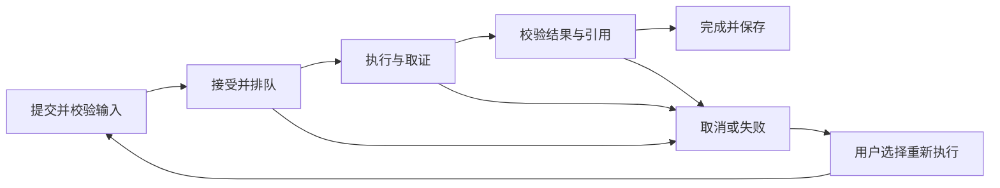

# Enterprise Agent Hub 产品需求文档

> 文档版本：1.0 · 首版产品基线  
> 更新日期：2026-11-06  
> 面向读者：产品负责人、设计者、开发者与验收人员  
> 确认范围：7 个模块、3 类任务、GitHub 只读接入；研发团队助手定位已获用户确认。  
> 实现状态：尚未初始化业务工程。本文描述目标行为与验收要求，不表示功能已实现或测试通过。

## 目录导航

- [1. 产品定位与目标](#1-产品定位与目标)
- [2. 用户、权限与共享边界](#2-用户权限与共享边界)
- [3. 信息架构与首次使用](#3-信息架构与首次使用)
- [4. 三类核心任务](#4-三类核心任务)
- [5. 七个功能模块](#5-七个功能模块)
- [6. 跨模块业务规则](#6-跨模块业务规则)
- [7. 状态、异常与恢复](#7-状态异常与恢复)
- [8. 非功能要求](#8-非功能要求)
- [9. 验收方案与发布条件](#9-验收方案与发布条件)
- [10. 交付阶段与后续范围](#10-交付阶段与后续范围)
- [11. 文档依据与变更管理](#11-文档依据与变更管理)

## 1. 产品定位与目标

### 1.1 一句话定位

一个面向小型研发团队的 AI 工作平台，结合产品/技术文档和 GitHub Issue、PR，完成有来源的文档问答、需求与方案对比、进展与风险总结，并让用户查看任务的实际执行过程。

### 1.2 用户问题与价值

| 用户问题 | 产品提供的帮助 | 可观察的价值 |
| --- | --- | --- |
| 新成员找不到接入规范，频繁打断同事 | 指定知识库问答与来源定位 | 从答案直接打开相关原文，继续追问 |
| PRD 与技术方案分开维护，难以核对遗漏和冲突 | 选定两份文档，生成有双向引用的对比表 | 可以逐条核对差异和待确认项 |
| 周报需要反复查任务、PR 和计划 | 按仓库与时间范围汇总进展和风险 | 完成项、阻塞项、推断和建议有明确依据 |
| AI 结果难以追溯，失败时不知道原因 | 展示检索、工具调用、状态、耗时与用量 | 能区分资料不足、数据源故障和运行失败 |

项目应提供完整前后端流程、组织隔离、RAG、单 Agent 工具执行、真实 MCP 接入与可观测性。迭代按功能范围与验收标准推进，不据此承诺固定交付日期。

### 1.3 首版范围与优先级

- **P0**：本文 7 个模块、3 类任务，以及贯穿其中的权限、来源、限额、异常恢复与基础质量验收，均属于首版。
- **后续候选**：人工确认后创建 Issue、定时周报、跨会话长期记忆、评测管理界面、多 Agent 协作、更多文档格式和数据源。
- **首版排除**：项目任务看板、自动改代码/提 PR、自动发布、任意脚本执行、用户任意添加 MCP 服务、工作流画布、插件市场、商业计费、SSO 和部门权限树。

首版保留多个 Agent 配置与三个任务模板，每次运行由一个 Agent 执行。任务模板是预设用途、输入与输出格式，不代表多个 Agent 自动协作。

### 1.4 成功标准

1. 新组织能完成“准备文档 → 配置 Agent/连接 → 发起任务 → 查看来源与轨迹 → 导出结果”。
2. 三类任务均有可重复的样例和明确判分标准，要求见第 9 节。
3. 无可用证据时明确说明不足；不编造引用、任务状态、风险事实或完成率。
4. 工具超时、模型异常、取消和页面刷新都有可理解的结果；已接受任务不静默丢失。
5. 组织间隔离和只读边界可用负向用例验证。

## 2. 用户、权限与共享边界

### 2.1 目标角色

业务用户包括开发者、产品经理和技术负责人；账户权限使用现有契约中的 owner、admin、member。业务岗位不额外产生权限角色。

| 能力 | 所有者 owner | 管理员 admin | 成员 member |
| --- | --- | --- | --- |
| 使用本组织已启用的 Agent 与知识库 | 可 | 可 | 可 |
| 查看、追问、导出自己的会话 | 可 | 可 | 可 |
| 审计本组织其他成员运行与相关输入/输出 | 可 | 可 | 不可 |
| 编辑知识库、上传/删除文档 | 可 | 可 | 不可 |
| 创建/编辑/启停 Agent | 可 | 可 | 不可 |
| 管理 GitHub 连接、仓库范围、工具 | 可 | 可 | 不可 |
| 管理模型连接及组织使用限额 | 可 | 可 | 不可 |
| 添加或移除普通成员 | 可 | 可 | 不可 |
| 任免管理员、转移组织所有权 | 可 | 不可 | 不可 |

### 2.2 首版共享规则

- 组织是团队隔离边界。知识库、已启用 Agent 和管理员明确共享的仓库面向本组织成员；首版不做逐文档、逐成员授权编辑器。
- GitHub 仓库加入允许列表意味着向本组织成员提供其授权查询结果。保存前向管理员明确展示共享范围；连接账号本身可访问的其他仓库不因此自动开放。
- 会话默认只出现在创建者的会话列表；owner/admin 从执行记录进入审计视图，可读相关输入输出，不代替成员继续对话。
- 首页和会话页提示“组织管理员可审计本组织运行”。首版没有公开分享链接。
- 用户可加入多个组织；切换组织必须切换全部列表、选择器、会话和订阅，旧组织的迟到响应不能更新当前页面。
- 成员被移除后，不能继续读取该组织任何数据，包括旧会话、事件和下载结果。

### 2.3 文档补全采用的产品默认值

以下是为使首版可实施而明确的默认行为，不额外扩大模块范围：账号采用邮箱与密码；成员加入采用管理员添加已注册账号；每组织一个 GitHub 连接，可配置多个允许仓库，每次任务只选择一个仓库；任务结果保存在会话及运行记录中，不另建“报告中心”。具体认证实现与服务配置由后续技术方案确定。

## 3. 信息架构与首次使用

### 3.1 七个导航模块

| 编号 | 模块 | 主要页面/区域 | 默认访问者 |
| --- | --- | --- | --- |
| M1 | 工作台 | 任务模板入口、最近会话、准备状态 | 所有成员 |
| M2 | 知识库 | 知识库列表、文档列表/详情、切片与检索试查 | 成员只读，管理员维护 |
| M3 | Agent 管理 | Agent 列表、配置详情/编辑、试运行入口 | 成员选择，管理员维护 |
| M4 | 对话与任务 | 会话列表、任务输入、结果、来源抽屉、执行进度 | 自己的会话 |
| M5 | 连接与工具 | GitHub 连接、允许仓库、可用工具及连通测试 | owner/admin |
| M6 | 执行记录与用量 | 运行列表/详情、步骤、错误与聚合统计 | 成员看自己，管理员看组织 |
| M7 | 团队与设置 | 组织、成员、账号、模型连接、使用限额 | 按权限显示 |

登录、注册和无组织引导属于 M7 的账户流程，不增加第八个业务模块。M1 不重复建设统计仪表盘；任务输入和结果统一由 M4 承载。

### 3.2 首次使用主流程

管理员先完成配置；普通成员进入组织后可直接使用已启用的 Agent。GitHub 只对需要项目进展的任务必需；文档问答和文档对比不得因未配置 GitHub 而被阻断。

首次进入空组织：owner/admin 看到“配置模型、上传资料、配置 Agent、连接 GitHub”的准备状态；member 看到缺少哪项条件及“联系管理员”，不显示无权限的创建按钮。预置模板是可选起点，未配置数据前不能伪装成可运行 Agent。

## 4. 三类核心任务

### 4.1 T1 文档问答

**目标**：根据团队资料回答问题，并支持用户核对依据和追问。

| 项目 | 规则 |
| --- | --- |
| 输入 | 必填问题、一个可用 Agent；在其绑定知识库内选择一个或多个知识库，可进一步限定文档 |
| 前置 | 已登录；属于当前组织；选择范围内至少一份可检索文档；模型可用 |
| 输出 | 回答正文、逐项引用、检索范围与资料限制；区分文档事实与建议 |
| 示例 | “支付模块接入有哪些步骤？异常退款如何处理？” |
| 限制 | 不联网补造企业内部答案；不跨出用户和 Agent 共同允许的资料范围 |

交互：选择“文档问答” → 选择 Agent 与知识范围 → 输入问题 → 开始 → 查看检索/生成进度 → 点击引用核对原文 → 在同一会话追问。选择范围在发送前可见，开始后本次运行的范围固定。

| 验收编号 | 条件、操作与预期 |
| --- | --- |
| T1-AC01 | 给定含答案的指定文档，发起问题后返回相符的核心事实；文档事实有可打开的引用 |
| T1-AC02 | 给定资料不包含答案，返回“当前资料不足”及缺少的信息；不得补造内部规定或不存在的引用 |
| T1-AC03 | 给定互相矛盾的资料，指出冲突并展示双方来源；未提供生效依据时不自行判定最新版本有效 |
| T1-AC04 | 给定已有会话，追问“那失败时怎么办”，使用本会话上下文重新检索；不得引入其他会话记忆 |

### 4.2 T2 需求与方案对比

**目标**：让用户发现选定需求文档与技术方案之间的潜在遗漏、差异和冲突。

| 项目 | 规则 |
| --- | --- |
| 输入 | 一个可用 Agent；两份不同且已就绪的文档，分别标为“需求文档”和“技术方案”；可选关注点 |
| 前置 | 两份文档均在当前组织和 Agent 的允许范围内；选择不可用文档时禁止开始并解释原因 |
| 输出 | 对比范围说明；对比表：需求点、方案描述、判断、需求引用、方案引用/未找到、建议核实事项 |
| 判断标签 | 已找到对应描述、存在差异、存在冲突、当前检索未找到、资料不足；不把“未检索到”直接等同“确实遗漏” |
| 示例 | “对比订单 PRD 与技术方案，重点检查退款、幂等和超时处理。” |

交互：选择模板 → 选择两份文档并确认各自角色 → 填写关注点 → 开始 → 展示实际使用的文档版本、章节/片段范围 → 逐行查看差异 → 打开两侧证据 → 追问指定条目或导出表格。

首版以检索到的证据进行辅助对比，不承诺全量长文档穷尽审查。遇到上下文或预算限制，必须在结果顶部标明覆盖限制，并建议缩小关注范围；不能显示“所有需求均已覆盖”。

| 验收编号 | 条件、操作与预期 |
| --- | --- |
| T2-AC01 | 给定两份含预置差异的样例文档，返回可定位到原文的差异条目，并列出双方来源 |
| T2-AC02 | 某需求未找到方案证据时，显示“当前检索未找到”，保留需求引用及覆盖限制；不伪造方案引用 |
| T2-AC03 | 只选择一份、选择同一份两次或选择处理中的文档时，开始按钮不可执行，输入保留且错误定位到相应字段 |
| T2-AC04 | 使用长文档触发检索/上下文裁剪时，结果明确显示实际覆盖范围；导出保留此说明 |

### 4.3 T3 进展与风险总结

**目标**：结合文档计划与当前可查的 GitHub 信息，生成可核验的阶段总结。

| 项目 | 规则 |
| --- | --- |
| 输入 | 一个允许 GitHub 查询的 Agent；一个允许仓库；起止日期；相关知识库；可选重点/版本名称 |
| 默认 | 最近 7 个自然日（含当天）；日期按页面显示的本地时区解释，查询区间包含起日、截止日次日零时之前 |
| 前置 | 起止日期有效、起日不晚于止日、止日不晚于当前本地日期；GitHub 连接和查询工具启用；所选知识范围内至少一份就绪文档 |
| 输出 | 查询仓库/区间/时区/时间；已观察进展、未完成与阻塞、风险与依据、待核实事项、建议 |
| 证据 | 文档引用与 Issue/PR 链接；说明 GitHub 记录是查询时的快照，不是历史时点重建 |
| 示例 | “结合本周 Issue、PR 和发布计划，给出支付模块进展与风险。” |

交互：选择模板 → 选择仓库、时间范围和知识库 → 确认查询范围 → 开始 → 检索计划并查询 Issue/PR → 必要时查询条目详情 → 展示分组总结 → 核对依据 → 追问或导出。

查询以区间内创建、更新、关闭的 Issue 或合并/更新的 PR 等可观测记录为依据，输出须注明实际使用的筛选口径。PR 中既有创建时间又有合并时间时，按所报告事件的时间归类。修改时间只能证明记录有更新，不能证明该周期内完成了全部工作。数据量超过本次运行预算时报告已覆盖范围与剩余限制，不生成假装完整的总数或完成率。

| 验收编号 | 条件、操作与预期 |
| --- | --- |
| T3-AC01 | 给定有 Issue、PR 和发布计划的样例仓库，输出进展、阻塞、风险、建议及来源；至少有真实 MCP 查询记录 |
| T3-AC02 | PR 合并只表述为合并，Issue 关闭只表述为关闭；没有部署/验收证据时不写“已上线”“已验收” |
| T3-AC03 | 查询成功但无匹配记录时说明“该查询范围未返回记录”，不推断团队没有工作；查询失败时不得显示“零条记录” |
| T3-AC04 | GitHub 为本任务必需来源而连接失效时，运行显示失败原因与重试入口；已取得的文档只作部分证据，不包装成完整进展总结 |
| T3-AC05 | 缺少截止日期、负责人或任务关联关系时，相关结论标为待核实；不能编造延期、责任人或数量指标 |
| T3-AC06 | 日期为空、倒置或超出当前日期，未选允许仓库，或所选资料均未就绪时禁止开始；错误定位到字段并保留其他输入 |

## 5. 七个功能模块

每一行编号同时标识功能和对应验收要求，可直接用于后续任务及测试关联。除明确标为后续的内容外，本节均为 P0。

### 5.1 M1 工作台

**用户目标**：迅速找到合适任务并进入已有工作。页面包含组织选择器、三个任务入口、最近会话和当前准备状态。

| 编号 | 功能与交互 | 验收标准 |
| --- | --- | --- |
| M1-01 | 展示文档问答、需求与方案对比、进展与风险总结三个入口，说明所需输入和产出 | 点击任一入口进入 M4，对应模板已选；不得直接发起付费模型调用 |
| M1-02 | 展示自己的最近会话，包含标题、Agent、更新时间和最近运行状态 | 点击后恢复原会话；不得展示其他普通成员会话；空列表给出开始任务入口 |
| M1-03 | 按模板检查模型、Agent、就绪文档、GitHub 等准备条件 | 缺失条件逐项说明；文档类任务在无 GitHub 时仍可进入；进入配置操作符合角色权限 |
| M1-04 | 切换组织后刷新全部工作台内容 | 新组织加载期间不显示原组织数据；无成员资格的组织不可选择 |
| M1-05 | 对请求失败保留页面框架并显示重试；首次无数据和筛选无结果使用不同说明 | 失败不显示为零会话或“已准备完成”；点击重试只重新读取数据 |

主流程：登录 → 进入组织工作台 → 选择任务或最近会话 → 在 M4 补充输入/继续工作。离开后返回可重新获取准备状态，避免已删除资料仍显示可用。

### 5.2 M2 知识库

**用户目标**：维护可信资料，并核对 Agent 实际能检索到的内容。

列表显示名称、说明、文档数、就绪/处理/失败计数和更新时间。文档详情显示原文件名、文件类型、大小、上传时间、处理状态、失败原因、当前处理版本、提取文本及片段定位。切片和检索试查属于可折叠的管理员调试区域，不占据成员主阅读区域。

| 编号 | 功能与交互 | 验收标准 |
| --- | --- | --- |
| M2-01 | owner/admin 创建、编辑知识库名称和说明；名称必填且同组织内唯一 | 空白/重名有字段提示并保留输入；修改后列表与选择器一致，其他组织同名互不影响 |
| M2-02 | 选择或拖入 PDF、TXT、MD；文件逐个校验并显示上传进度；限制沿用契约 | 不支持格式、超限、空文件在提交前给出原因，后端再次校验；一个文件失败不掩盖其他文件状态 |
| M2-03 | 区分传输完成与文档处理完成；上传期间可取消当前传输 | 上传成功仅显示待处理/处理中；只有完成解析、切片与向量化后才可选择检索；传输取消不显示入库成功 |
| M2-04 | 处理失败显示原因及重试入口；保留原文件记录和历次处理尝试 | 损坏、加密、扫描无文本的 PDF 有可理解原因；失败重试产生新处理尝试，连点不能重复创建同次任务 |
| M2-05 | 预览提取文本与切片；PDF 展示可用页码，TXT/MD 展示标题/段落等定位 | 引用与预览指向相同文档版本及片段；不能给 TXT/MD 伪造 PDF 页码；非就绪文档不显示假切片 |
| M2-06 | 管理员输入查询做检索试查，显示片段、文档和定位 | 不生成正式 Agent 会话；结果只来自当前知识库和可见文档；没有结果如实显示 |
| M2-07 | 删除文档前展示影响：不再可检索，历史来源标记删除；确认后列表更新 | 删除提交后新检索和来源正文预览立即不可访问；历史答案保留并标记来源已删除；清理失败有可追踪状态 |
| M2-08 | 删除知识库时检查绑定 Agent | 被 Agent 引用时阻止删除并列出引用者；解除绑定后再次确认可删除，不静默修改 Agent 配置 |
| M2-09 | 支持按文件名/状态筛选、分页；同名文件以独立记录展示 | 不覆盖已存在的同名文档；选择器以名称、时间等区分；失败记录可重新定位；列表不泄露其他组织文档 |

主流程：创建知识库 → 添加文件 → 查看传输与处理状态 → 就绪 → 核对原文/检索试查 → 绑定 Agent。客户端在上传接受结果丢失时先查原请求状态，不直接以新身份重传。上传已被接受后如需撤回，使用删除文档，不把“取消上传”当作取消后台处理的承诺。

首版不提供 OCR、在线编辑文档、批量版本比较或复杂目录树。失败重处理形成内部文档版本，用于引用一致性；用户替换资料采用上传新文档、确认可用后删除旧文档。

### 5.3 M3 Agent 管理

**用户目标**：把常见工作方式保存成可重复使用的助手配置。

配置字段：名称、说明、任务模板、提示词、知识库选择、允许工具、管理员配置的可用模型、启用状态。提示词可编辑；授权范围、执行上限和只读约束不能通过提示词覆盖。

| 编号 | 功能与交互 | 验收标准 |
| --- | --- | --- |
| M3-01 | 展示 Agent 列表，成员可看说明、适用任务和开始入口，管理员可编辑 | 未启用 Agent 不出现在成员可用列表；直接链接不能绕过使用权限 |
| M3-02 | 从空白或三种预置模板创建 Agent；名称与模板必填 | 模板填入对应输入/输出约定，用户可修改提示词；创建的是配置，不自动运行或创建协作 Agent |
| M3-03 | 绑定组织内知识库及允许工具；可保存未完整配置的停用 Agent | 启用或开始试运行前检查必需条件；悬空知识库、缺少模型或任务必需工具时阻止并指出具体问题 |
| M3-04 | 保存编辑后生成可追溯配置版本；离开未保存表单提示放弃/继续编辑 | 已运行任务仍展示原配置版本；新运行使用最新有效配置；保存失败保留表单 |
| M3-05 | 复制 Agent 为新的停用配置，名称要求重新确认 | 复制不产生共享的可编辑实例；只保留本组织有效资源引用，不复制连接凭据到 Agent 内容 |
| M3-06 | 管理员启用/停用；停用说明对新任务和在途任务的影响 | 停用后不能创建新 run；在途运行在下个授权检查点停止并给出原因，不能再开始新的工具调用 |
| M3-07 | “试运行”进入 M4，清楚标识使用已保存配置且会计入用量 | 未保存修改不能被误认为已生效；试运行产生真实会话/运行记录，返回后可继续编辑 |

主流程：选模板 → 填写说明与提示词 → 绑定知识库/工具/模型 → 保存 → 检查条件并启用 → 试运行 → 根据有来源的结果调整配置。首版使用停用管理退出使用，不额外提供会破坏历史记录的物理删除入口。

### 5.4 M4 对话与任务

**用户目标**：发起三类任务、看到可信结果并持续追问。推荐布局为会话列表、对话主体、可展开的来源/执行详情；窄窗口采用抽屉，布局实现由设计阶段确定。

| 编号 | 功能与交互 | 验收标准 |
| --- | --- | --- |
| M4-01 | 新建会话时选择 Agent/任务类型，填写对应输入；提交前展示资料、仓库和时间范围摘要 | T1/T2/T3 分别执行第 4 节字段校验；空输入/无权限/未就绪资料不能发起；表单错误保留输入 |
| M4-02 | 点击开始立即进入提交状态，服务端接受后展示排队/执行状态 | 快速连点或请求重发只对应一个 run；接受结果不明时查询原请求，不能自动创建第二次运行 |
| M4-03 | 流式展示回答、检索与工具状态；生成中的文本标为进行中 | 部分文本不得提前显示成功、正式引用已验证或可导出最终报告；最终结果以服务端状态为准 |
| M4-04 | 引用点击打开来源抽屉，展示文档版本/定位/片段，或外部条目摘要、链接及查询时间 | 每个引用能映射到本次实际证据；已删除/权限失效的来源显示不可用，不从缓存泄露正文 |
| M4-05 | 终态后支持继续追问；当前会话固定 Agent 和任务类型，需切换时新建会话 | 历史对话可作为上下文但不能替代当前证据；追问中扩展范围需用户在选择器明确调整，不能仅靠 Prompt 越权 |
| M4-06 | 运行中可点击停止；显示“正在停止”，保留已有部分内容并标识不完整 | 收到取消终态后显示“已取消”；停止请求失败可重试；取消与完成竞争时只显示服务端唯一终态 |
| M4-07 | 失败、超时或取消后可“使用当前配置重新执行”，原结果保留 | 保留原输入并重新校验权限/资料，创建新 run 且关联原运行；不用旧权限、旧预算续跑；同会话已有运行时禁止重试 |
| M4-08 | 刷新、离开再返回、网络重连时恢复消息与原运行状态 | 不新建 run、不重复消息、不漏掉最终状态；连接中断有提示，恢复后从实际历史续接；关闭页面不等于取消 |
| M4-09 | 已完成结果支持复制正文及下载 Markdown | 导出包含任务输入范围、生成时间、答案、来源和覆盖限制；部分内容仅可显式“复制部分文本”并附未完成标记 |
| M4-10 | 会话按更新时间排序，支持标题搜索与重命名；展示每轮运行入口 | 修改标题不改变内容或运行；不同用户、组织列表隔离；管理员审计入口只读，不允许代发追问 |

主流程：选任务与范围 → 提交 → 观察执行 → 核对结果和引用 → 追问/导出。长任务期间输入草稿可保留；同一会话有非终态运行时禁止再次发送，但不锁定其他会话。临时文件上传统一先到知识库处理，不在对话内建立绕过知识库权限的第二套附件通道。

### 5.5 M5 连接与工具

**用户目标**：将明确授权的 GitHub 仓库作为项目进展来源，知道哪些工具可用以及是否连接正常。

首版只有 GitHub 一个外部提供方，每组织配置一个连接。工具清单只包含查询/列出/搜索/读取 Issue、PR 及必要的仓库可读性验证；本地知识检索属于系统内置工具。GitHub MCP 的具体版本和连接部署方式由技术方案确定，产品界面不允许任意服务 URL 或启动命令。

| 编号 | 功能与交互 | 验收标准 |
| --- | --- | --- |
| M5-01 | owner/admin 填写连接名称和凭据，保存前进行连接测试；提供方固定为 GitHub | 成员不能读取/修改凭据；保存后只显示掩码及状态；凭据仅经受保护的配置请求提交，不出现在 URL、返回页面、公开响应、普通日志与模型上下文 |
| M5-02 | 显示未配置、可用、异常、停用等界面状态，以及最近测试时间和可执行提示 | 测试失败保留可编辑内容，区分认证失效、权限不足、网络/限流；“上次测试可用”不保证下一次调用必定成功 |
| M5-03 | 管理员按 owner/repo 添加允许仓库并验证可读性，保存前确认向组织共享 | Agent 和成员选择器仅列允许仓库；凭据能访问的其他仓库不会自动出现；手工构造越界参数被拒绝 |
| M5-04 | 每次任务只选择一个允许仓库；查询参数限定在选定仓库和输入范围 | 模型输出的 repo、query 或资源链接不能扩大授权；查询失败时不跨仓库搜索替代结果 |
| M5-05 | 展示工具用途、输入摘要、只读标记与启用状态；Agent 只能选择启用工具 | 即使外部服务返回写工具定义，平台也不允许调用；创建/修改 Issue、评论、合并 PR、推送、触发工作流均无法执行 |
| M5-06 | 更新凭据需重新测试；停用连接、移除仓库或停用工具前显示影响 | 新任务立即不可用；在途运行在下次调用/结果交付检查时复核，不能继续使用撤销范围的结果；历史记录保留但受当前访问范围限制 |
| M5-07 | 查询结果保留条目 ID、标题、状态、链接、相关时间、抓取时间和必要证据摘要 | 同一个条目在多次查询出现时不重复计数；Issue 与 PR 按真实类型区分，不把 PR 再计入普通 Issue |
| M5-08 | 对分页、结果裁剪、工具超时和配额限制显示覆盖边界 | 能继续取证时在预算内继续；不能完成必需取证时显示失败或明确资料限制；未获取结果不能被计入统计与结论 |

主流程：管理员配置 → 测试 → 添加并确认共享仓库 → 启用连接/查询工具 → Agent 绑定工具 → 成员在任务中选择仓库。GitHub 普通成员个人登录态不等于本平台连接授权；管理员必须选择允许向团队共享的范围。

首版按需查询，不做全量仓库镜像、Webhook 同步、GitHub Projects 看板或源代码自动审查。外部链接在新窗口打开，其可访问性仍由 GitHub 判断；本平台不绕过 GitHub 权限。

### 5.6 M6 执行记录与用量

**用户目标**：理解一次任务做过什么、为何成功或失败，以及消耗多少资源。

| 编号 | 功能与交互 | 验收标准 |
| --- | --- | --- |
| M6-01 | 运行列表按时间展示 Agent、任务类型、发起者、状态、耗时与用量；可按状态/Agent/时间筛选和分页 | 成员仅见自己运行，管理员可切换组织审计视图；列表筛选与统计使用相同权限范围 |
| M6-02 | 详情展示输入摘要、资料范围、配置版本、开始/结束时间、状态、结果/失败原因 | 对话页能跳到同一 run；历史运行不因 Agent 改名或改配置而失去原始上下文 |
| M6-03 | 展示实际检索、模型调用、工具调用、重试及结果校验的时间线，步骤可展开 | 显示工具名、允许公开的参数/结果摘要、来源、耗时和错误；不展示或要求采集模型隐藏思维链 |
| M6-04 | 分开显示排队时长、执行时长、模型调用用量；失败/取消尝试也计入 | 同一 run 不因事件重发重复累计；Token 缺失时标为估算或不可得，不能填 0 冒充实测 |
| M6-05 | 提供运行总数、各终态数量、运行成功率、Token 合计和执行耗时概览 | 成功率=成功终态数/全部终态数，排队/运行中不入分母；分母为零显示“暂无”；区间以 run 创建时间筛选 |
| M6-06 | 错误详情给出用户可行动的说明和关联任务入口 | 权限失败提示检查范围，连接失败提示联系管理员，预算耗尽提示缩小任务；不返回堆栈或原始凭据 |
| M6-07 | 关联重试运行；配置和证据允许按历史查看，资源失效显示明确标记 | 能从原失败记录定位重试；只读查看历史不重新调用模型/工具；删除来源不显示伪造替代内容 |

主流程：从对话或执行列表进入详情 → 核对实际步骤与来源 → 查看错误/用量 → 回到自己的会话处理。管理员审计不能代替成员发起或取消任务。

运行成功率衡量系统交付终态，不等同于答案有用率；“资料不足”的有效说明可成功交付，但不得计为已解决业务问题。首版不提供货币账单、复杂计费或模型价格估算。

### 5.7 M7 团队与设置

**用户目标**：建立团队空间、控制成员权限，准备模型和使用边界。

| 编号 | 功能与交互 | 验收标准 |
| --- | --- | --- |
| M7-01 | 邮箱与密码注册、登录、退出；邮箱格式/唯一性检查，密码 8～128 字符 | 重复邮箱不能注册；错误提示不泄露密码；登录后进入组织选择；退出后旧会话不能继续调用受保护接口 |
| M7-02 | 无组织用户可创建组织并成为 owner；已有成员可选择组织；名称必填 | 创建只发生一次；创建者权限正确；没有成员关系的组织即使知道 ID 也不可进入 |
| M7-03 | owner/admin 按邮箱添加已注册账号为 member；展示成员名、角色和加入时间 | 账号不存在给出先注册提示；重复加入不产生重复成员；添加前明确目标账号，admin 不能直接授予管理员 |
| M7-04 | owner 任免管理员并转移所有权；owner/admin 可移除普通成员 | 转移对象必须是当前有效成员且二次确认，原 owner 转为 admin；组织始终保留一个 owner；admin 不能移除/降级 owner 或 admin |
| M7-05 | 成员移除或权限变更立即影响后续访问；组织切换清理旧请求与订阅 | 被移除成员不能继续读取事件、引用、下载和历史；在途工具执行复核当前权限，不能依赖旧角色缓存 |
| M7-06 | 管理员配置聊天模型、Embedding 与重排服务；显示模型标识、连接状态与测试入口 | 测试使用最小输入并提示可能产生用量；保存后成员只看到可选模型名称；模型凭据不出现在浏览器公开状态 |
| M7-07 | 管理员查看运行/上传硬限制，并在允许范围设置更低的组织使用上限；成员可查看影响当前操作的限制 | 提交前展示相关限制，后端执行最终裁决；不能通过 Prompt 或修改客户端绕过；数值来源以契约与部署配置为准 |
| M7-08 | 模型配置修改前说明对新运行和文档索引的影响；展示当前生效状态 | 聊天模型变更只作用于新运行；已有文档时 Embedding 模型/维度配置在首版界面只读，说明变更需要维护重建；不得混用新旧索引或破坏在途入库 |
| M7-09 | 账号页可修改显示名和密码；改密码要求验证当前密码 | 修改显示名不改变身份；密码变更撤销旧登录会话并要求重新登录；失败保留非敏感表单字段并提示原因 |

主流程：注册/登录 → 创建或选择组织 → 配置模型 → 添加已注册成员 → 分配角色 → 成员使用。首次部署可提供明确标识的开发样例账号和资料，用于演示组织隔离；不能在正式环境自动导入或覆盖真实数据。

首版不含邮件验证、邮件邀请、忘记密码自助邮件、账户/组织自助删除或企业 SSO；界面不展示不可用入口。邮箱在首版是登录标识，未验证邮箱不能被宣称为已验证身份。成员退出组织由管理员移除处理；owner 必须先转移所有权。

## 6. 跨模块业务规则

### 6.1 范围、配置与版本

1. 有效资料范围取当前组织、当前成员权限、Agent 绑定范围与用户本次选择的交集。向量检索、工具参数、来源预览和导出使用同一边界。
2. 会话固定组织、创建者、Agent 和任务类型；下一轮可在允许范围内调整知识库、仓库或日期，调整只影响新 run。页面显示每轮实际范围。
3. run 开始前固化 Agent 配置、提示词、模型、资料选择及预算版本；编辑配置不能改写历史。当前权限撤销仍即时生效，快照不冻结授权。
4. 文档引用绑定具体处理版本与片段。GitHub 引用绑定仓库、类型、编号、链接和查询时间；同一条目后来变化不篡改历史快照的含义。
5. 首版不设置独立“项目”实体。知识库可按项目命名，Agent 绑定相关知识库，任务选择仓库；避免引入第二套成员和任务归属体系。

### 6.2 可信结果与引用

- 来源必须来自本次实际取回且当前允许访问的证据；文档里的指令、工具输出和历史消息不能改变权限或系统规则。
- 文档事实引用原文，项目状态引用对应 Issue/PR；建议、推断和不确定结论有明显标签。
- 无证据的风险不能写成确定事实；未提供截止日期不能断言延期，未提供总工作量不能计算完成率。
- 同一回答存在资料冲突时同时呈现双方来源与差异；用户手工确认的偏好不得变成跨会话长期记忆。
- 引用校验不通过时不能发布带伪引用的最终答案；可在剩余预算内修正，否则失败并说明原因。
- 合法的“依据不足说明”可以成为成功交付结果；必需工具故障、预算耗尽或流程未完成不能伪装成这种成功。

### 6.3 删除、停用与历史

| 变更 | 新操作 | 在途运行 | 历史结果 |
| --- | --- | --- | --- |
| 删除文档 | 立即不可检索/预览 | 结果交付前排除该来源；无法满足任务时说明不足或失败 | 已生成文本保留，引用标记“来源已删除”，不再提供原文 |
| 删除知识库 | 有 Agent 引用时阻止；解除引用后确认删除 | 同文档删除规则 | 原引用保留删除标记 |
| 编辑 Agent | 新 run 使用新版本 | 使用已固化配置，仍受当前授权限制 | 保留原版本 |
| 停用 Agent/工具/连接或移除允许仓库 | 阻止相关新运行/调用 | 下个检查点停止相关调用，不提交已撤销来源的新结果 | 保留运行元信息；不再开放被撤销来源正文 |
| 移除组织成员 | 失去该组织全部访问 | 关闭订阅；运行在检查点停止 | 该成员不能再访问，管理员仍可审计 |

删除文档不自动抹去用户此前已合法生成或下载的文本；历史答案提示来源变化。连接停用或仓库移除时，界面与导出应隐藏包含该来源内容的历史回答正文及步骤结果，仅保留运行元信息和“来源访问已撤销”说明，避免由已保存的混合回答继续暴露仓库信息。重新开放范围后再按当前权限读取。

### 6.4 运行、取消与重试

具体运行状态、错误码、SSE 事件及数值上限以 [接口与事件契约](contracts.md) 为唯一维护位置。停止请求是中间标记，不是已经取消；关闭浏览器不停止后台任务。超时和取消结束本次运行，用户重新执行会得到新的 run，不重置旧运行预算继续循环。

同一会话只允许一个非终态 run。自动重试仅处理可恢复的暂时故障并计入原运行预算；人工重新执行沿用原输入、重新校验当前配置与权限，关联旧 run 并保留两次记录。

## 7. 状态、异常与恢复

### 7.1 用户可见状态

| 对象/阶段 | 页面呈现 | 允许的下一步 |
| --- | --- | --- |
| 文件上传 | 传输中、传输失败、传输取消 | 等待、取消传输、修正后重传 |
| 已接受文档 | 待处理、处理中、可检索、处理失败 | 查看进度；成功后使用；失败重试或删除 |
| 任务提交 | 提交中、提交结果待核对 | 保留输入、查询原请求；不自动重复提交 |
| 后台任务 | 排队中、执行中 | 观察进度、请求停止、离开后返回 |
| 停止请求 | 正在停止 | 等待服务端终态；网络失败可重试停止请求 |
| 任务终态 | 已完成、失败、已取消、超时 | 查看证据/错误；符合权限时新建一次重试 |
| 事件流连接 | 已连接、重连中、连接中断 | 恢复同一运行；不能把连接中断当作任务失败 |
| 来源 | 可查看、已删除、访问已撤销、暂不可用 | 核对来源或补充资料，不替换为其他来源冒充原引用 |

上述为产品文案，不新增后端状态枚举。文档删除可见性、cancelRequested、运行终态和事件去重均遵循 [contracts](contracts.md) 与 [Agent 规范](agent.md)。

### 7.2 异常交互矩阵

| 情况 | 用户看见什么 | 系统应做什么 | 禁止出现的结果 |
| --- | --- | --- | --- |
| 未登录/登录过期 | 登录提示，非敏感输入可保留 | 停止受保护读取；登录后重新校验资源 | 匿名继续订阅原组织事件 |
| 资源不存在或越权 | 资源不可用/无权限说明 | 后端拒绝，清理不再授权的页面内容 | 暴露另一组织资源标题或正文 |
| 无资料/文档未就绪 | 缺少可用文档，给出对应准备入口 | 阻止依赖该文档的新任务 | 从未解析文件生成假引用 |
| 上传超限或不支持格式 | 文件级原因、允许格式/限制 | 保留其他文件处理结果；无效文件不入库 | 仅在文件选择器限制，拖拽可绕过 |
| 解析失败 | 明确原因、重试/删除入口 | 保留失败状态和尝试记录 | 显示可检索或静默启动 OCR |
| 队列暂时不可用 | 已接受任务仍可查询，显示等待 | 保存待投递任务并补偿；不假报执行完成 | 已接受任务消失或重复执行 |
| 没有检索结果 | 当前范围缺少证据，建议补资料/缩范围 | 返回合规的不足说明，记录实际检索 | 用模型常识编造企业事实 |
| GitHub 查询空结果 | 本范围未返回记录 | 保存查询范围/时间与空结果证据 | 把空结果解释为团队零产出 |
| GitHub 或模型不可用 | 对应来源/服务失败，说明可重试或联系管理员 | 在预算内有限重试；必需调用仍失败则结束 | 无结果时展示“查询成功” |
| 达到执行预算/最长时间 | 超时或预算耗尽，显示部分结果标记 | 停止新的模型/工具调用并保存终态 | 自动延长预算、无限循环 |
| 网络断开/刷新 | 重连中或状态读取失败，历史内容不重复 | 补回同一 run 的事件/快照 | 重复发送用户消息或丢失终态 |
| 取消与完成同时发生 | 展示最终确认的一个状态 | 条件更新保证唯一终态 | 同一 run 同时显示成功和取消 |
| 页面停留期间资源被停用/删除 | 明确指出已失效项 | 提交及结果展示再次检查范围 | 沿用过期选择器绕过权限 |
| Markdown/文档含脚本或“忽略规则”内容 | 安全文本与受限链接 | 当作资料而非执行命令；按权限渲染 | 脚本执行、跨组织检索、写 GitHub |

## 8. 非功能要求

本节是待实现的验收要求。当前没有测得的性能、可用性或费用数据；不将目标写为已达成 SLA。

| 编号 | 要求 | 验收方式 |
| --- | --- | --- |
| NFR-01 | 组织隔离覆盖业务记录、检索、重排输入、来源、下载、会话、运行与事件 | 用两个组织交换各类 ID/链接/事件订阅，所有越权请求被拒；对模型输入做证据检查，无他组织片段 |
| NFR-02 | GitHub 全链路只读，模型和文档不能提升权限 | 构造“创建 Issue/合并 PR/换仓库”等请求和恶意资料；工具层拒绝，外部仓库无写入效果 |
| NFR-03 | 每次运行执行硬预算，重试也计入；上传限制可见且后端执行 | 对 [contracts 的初始限额](contracts.md#状态与初始限额) 每项测试边界值和越界值；触顶后无新增调用 |
| NFR-04 | 已接受文档和运行可持久查询，worker 中断可恢复或明确失败 | 在入库、取证、终态提交等位置重启进程；任务不丢失，不出现双终态；不可恢复时返回中断原因 |
| NFR-05 | 同键重发幂等，同键不同输入明确冲突；事件补拉不会重复消息 | 重复提交、响应丢失、重复/乱序事件测试，核对文档/run/消息数量与状态 |
| NFR-06 | 失败、取消和超时后回收由该运行持有的订阅与临时资源 | 反复进入离开页面、取消任务及服务重启，检查连接/任务不持续积累；不取消其他用户工作 |
| NFR-07 | 登录、密码、连接凭据和富文本按项目既定安全边界处理 | 验证密码不以明文持久化，公开响应/日志无凭据，注销撤销会话，表单防伪造请求，Markdown 不执行脚本 |
| NFR-08 | 核心流程可用键盘完成；表单标签、焦点、错误及停止状态可识别 | 使用键盘完成登录、选模板、上传、发送、查看来源；错误信息不只靠颜色表达 |
| NFR-09 | 以简体中文界面为首版，文档和提问可含中英文，引用保留原文 | 混合中英文样例可检索并定位；用户未指定时跟随问题语言作答；不增加整站多语言设置 |
| NFR-10 | 时间明确显示时区；筛选区间与统计口径可复现 | 用跨零点、跨时区样例验证 T3 与 M6 区间；导出包含时区和查询时间 |
| NFR-11 | 列表分页、长内容按需展开；提交/取消有即时操作反馈 | 提交后无需等待模型回复即可看见操作状态；记录代表性数据量下加载、执行与 Token 指标，不伪造固定低延迟承诺 |
| NFR-12 | 数据质量与运行成功分开衡量，检索及回答质量分开记录 | 固定评测集输出检索命中、事实正确、引用支持、任务完成、耗时与用量；保留模型/Prompt/文档版本 |

文件上限、模型/工具时限、执行步数、重试及 Token 数值集中维护在 contracts；本 PRD 不另建一套数字。跨会话并发上限、文档处理最长时间与对象清理保留期须在部署方案中给出具体值并进入对应验收，不默认为无限。

## 9. 验收方案与发布条件

### 9.1 验收资料包

建立独立的开发/测试资料，不使用真实企业内部数据。样例文字和仓库记录应标明为演示数据，但真实集成演示必须真正调用模型和 MCP，不能用假数据冒充在线调用。

| 资料 | 内容与用途 |
| --- | --- |
| 组织 A 与 B | 各包含 owner/admin/member，名称相似、内容不同，用于隔离和权限测试 |
| 知识库 A | 接入说明、需求文档、技术方案、发布计划；预置可回答事实、冲突和不包含答案的问题 |
| 上传样本 | 正常 PDF/TXT/MD，以及损坏、加密、扫描无文本、空文件、错误类型和大小边界文件 |
| GitHub 样例仓库 | 有明确关联的 Issue/PR，含关闭、未完成、已合并、区间外及无匹配记录等情形 |
| 对抗样本 | 要求换组织、扩大仓库范围、输出凭据、伪造引用、调用写工具的资料和用户输入 |
| 故障场景 | 模型不可用、GitHub 无权限/限流、队列故障、worker 重启、断网、取消竞态 |

### 9.2 可重复业务验收

每类任务准备 4 个正常/边界业务案例，共 12 个；每个以同一配置运行 3 次，共 36 次，保留全部结果而非挑选最好一次。案例必须在实现前写出关键事实、必要来源、覆盖边界和期望的不足说明。

- 单次案例通过：满足该任务相关 AC；关键事实正确；引用真实且支持相应主张；没有遗漏该案例预先指定的必需输出部分。
- 首版质量门槛：每类至少 11/12 次通过，且无伪造引用、越权内容、越权工具调用或违反预算行为。
- 无答案案例按正确说明不足计为任务通过；不能为了通过率强行生成答案。
- 质量门槛是首版小样本验收标准，不表示对真实业务的整体准确率承诺。模型、提示词或检索配置变化后重新运行受影响案例。
- 权限、取消、幂等、队列、重启、凭据与只读负向测试按第 7、8 节逐项执行，不用上述 36 次问答代替工程验证。

### 9.3 端到端验收路径

| 编号 | 路径 | 必须观察到的结果 |
| --- | --- | --- |
| E2E-01 | owner 创建组织 → 配置模型 → 上传文档 → 创建/启用 Agent → member 文档问答 | 成员得到有来源的回答，并能从引用定位到实际原文 |
| E2E-02 | 选需求与方案 → 指定关注点 → 查看对比 → 打开双侧来源 → 导出 | 差异与预设样例相符；未检索到和覆盖限制原样保留 |
| E2E-03 | 管理员配置只读 GitHub → 选仓库/日期/计划 → 生成进展总结 → 查看轨迹 | 真实 MCP 只读调用；状态和链接正确；推断与事实分开 |
| E2E-04 | 开始运行 → 断网/刷新 → 恢复 → 停止 → 新建重试 | 恢复同一运行，无重复消息；停止有唯一终态；新 run 与旧记录关联 |
| E2E-05 | 管理员移除仓库/成员或删除文档 → 使用旧链接/旧页面继续操作 | 后端拒绝或隐藏已撤销数据，不能凭缓存或旧快照继续访问 |
| E2E-06 | 切换到组织 B → 猜测组织 A 资源 → 查看用量 → 退出登录 | 文档、运行、统计与事件都隔离；退出后会话撤销 |

### 9.4 需求追踪表

| 用户确认范围 | 本文落点 | 验收集合 |
| --- | --- | --- |
| 工作台 | §5.1 | M1-01～M1-05、E2E-01 |
| 知识库 | §5.2 | M2-01～M2-09、T1/T2、E2E-01/02/05 |
| Agent 管理 | §5.3 | M3-01～M3-07、E2E-01 |
| 对话与任务 | §5.4 | M4-01～M4-10、T1/T2/T3、E2E-01～04 |
| 连接与工具 | §5.5 | M5-01～M5-08、T3、NFR-02、E2E-03/05 |
| 执行记录与用量 | §5.6 | M6-01～M6-07、NFR-05/10/12、E2E-03/04/06 |
| 团队与设置 | §5.7 | M7-01～M7-09、NFR-01/07、E2E-01/05/06 |
| 文档问答 | §4.1 | T1-AC01～T1-AC04 |
| 需求与方案对比 | §4.2 | T2-AC01～T2-AC04 |
| 进展与风险总结 | §4.3 | T3-AC01～T3-AC06 |
| GitHub 只读接入 | §5.5、§6.2 | M5 全部、NFR-02、E2E-03/05 |

### 9.5 首版完成定义

只有同时满足下列条件，才能声明首版产品完成：

1. 本文 P0 功能与验收集合有对应实现及证据，所有阻断缺陷关闭。
2. 六条端到端路径通过；权限、伪引用、写工具、预算越界和双终态问题为零容忍。
3. 固定业务评测达到 §9.2 门槛，记录运行日期、版本、模型与波动，不仅展示截图。
4. 至少一条真实模型与 GitHub MCP 联调路径成立；隔离 mock 结果单独标识。
5. Docker 启动、环境配置、样例数据、使用说明、已知限制可供他人复现；应用实际命令以工程建立后的 README 为准。
6. 删除/停用/成员撤销、失败/取消/恢复的行为与契约一致，临时验证服务已清理。

当前只完成产品文档编写，以上产品验收均尚未执行。

## 10. 交付阶段与后续范围

| 阶段 | 进入条件 | 退出条件 | 遗留项处理 |
| --- | --- | --- | --- |
| 产品定义（当前） | 用户已确认首版模块、任务和只读接入 | PRD 覆盖功能、交互、异常及可检验标准；规范无矛盾 | 技术实现选择列入下一阶段，不以 PRD 编写代替实现 |
| 技术设计 | 用户另行要求进入下一步 | 数据、权限、运行恢复、接口、部署和验收方案可实施，需求编号可追踪 | 实现难点需要调整产品行为时明确回到 PRD 修订 |
| 工程与功能交付 | 技术方案完成并获得对应开发授权 | P0 实现与针对性验证完成 | 未通过能力标为未完成，不静默移出 P0 |
| 首版验收与展示 | 功能可运行 | 达到 §9.5，有可复现演示与已知限制 | 后续候选独立排期，不以“即将支持”冒充现有能力 |

后续候选的启动依据：写操作需要真实使用需求与授权/预览/幂等设计；定时周报需要已稳定的手动总结；长期记忆需要明确保存内容和用户控制；评测界面需先有可用固定评测集；多 Agent 协作需证明单 Agent 无法合理完成任务。以上均不属于本次代码实施授权。

技术方案待确定但不影响本次产品定义的事项：依赖版本、认证会话时长、模型提供方、MCP 运行方式、部署环境、资源限额和保留清理策略。技术方案必须填实数值和异常行为，不能用“由配置决定”跳过验收。

## 11. 文档依据与变更管理

### 11.1 文档责任

- 本文维护用户目标、范围、交互和验收；[架构规范](architecture.md) 维护模块职责与数据归属；[契约](contracts.md) 维护状态、接口、事件和数值预算。
- [前端规范](frontend.md)、[后端规范](backend.md)、[Agent 规范](agent.md)、[质量规范](quality.md) 约束实现；[文档索引](README.md) 与项目入口只维护跳转和摘要。
- 本次沿用现有角色、上传格式、单 Agent、只读工具、会话恢复和预算边界，未新增业务状态枚举或接口路径。后续实现不得因为本文是 PRD 而绕过既有权限与运行契约。
- 产品默认值在 §2.3 和相关模块中明确。用户后续调整时，更新相应需求编号、受影响流程、验收与引用，保留修订记录。

### 11.2 来源

- 用户在本会话确认：研发团队助手定位，7 个模块、3 类任务、GitHub 只读接入；要求先完成完整 PRD，暂不写代码。
- 实现状态以各阶段验收记录为准；规划中的技术栈和工期不作为已实现事实。
- [GitHub MCP Server 官方说明](https://github.com/github/github-mcp-server) 和 [远程服务只读配置](https://github.com/github/github-mcp-server/blob/main/docs/remote-server.md)：2026-11-06 已核对存在 Issue/PR 工具集和只读配置；本项目接入尚未实现，初始化时重新核对选定版本。

### 11.3 修订记录

| 日期 | 版本 | 变更 | 确认/实现边界 |
| --- | --- | --- | --- |
| 2026-11-06 | 1.0 | 将确认范围整理为完整 PRD，补齐功能、交互、异常、权限及验收 | 总体范围已确认；产品默认细节为本次文档设计；未进行应用开发或功能验收 |

