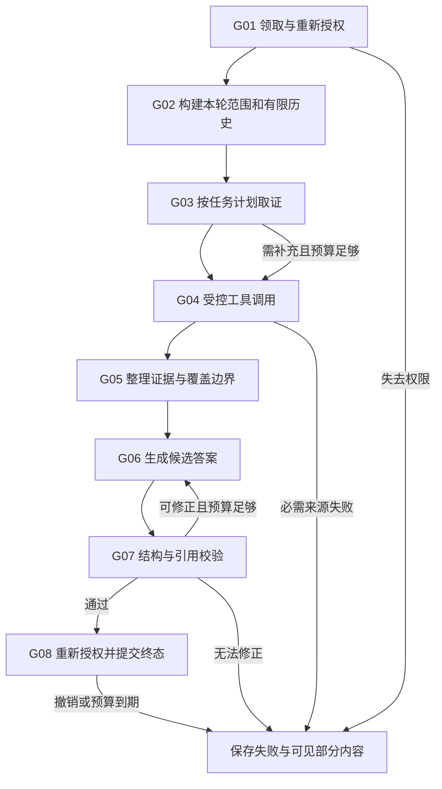

# Agent、检索与只读工具执行设计

> 版本 1.2 · 2026-11-09 · T1 持久问答、SSE 页面及 D10 有限取消恢复已实现；T2 compare-v1 已实现有界双侧检索，真实模型业务评测待验证；T3 按后续任务实施。需求依据：[PRD 三类任务](PRD.md#4-三类核心任务)。通用状态、数值和 API 以 [contracts](contracts.md) 为准；恢复边界见 [D10 记录](D10-取消与进程恢复实施记录.md)。

## 目录导航

- [执行边界与状态](#执行边界与状态)
- [统一执行图](#统一执行图)
- [文档处理与混合检索](#文档处理与混合检索)
- [三类任务专用流程](#三类任务专用流程)
- [工具注册与 GitHub MCP](#工具注册与-github-mcp)
- [预算、取消与恢复](#预算取消与恢复)
- [结果校验与证据可见性](#结果校验与证据可见性)
- [验收与评测](#验收与评测)

## 执行边界与状态

首版是一个 LangGraph 有状态执行图，加三种确定的任务分支。Agent 配置保存模板、Prompt、模型与允许范围；不派生协作 Agent，不做任意工作流、不写跨会话长期记忆。模型可以提出补充查询，但每个调用必须通过服务端固定工具与授权检查。

图状态仅含 runId、组织/用户 ID、agentVersionId、taskType、inputSnapshot、scope、historyMessageIds、evidenceIds、candidateResult、validationErrors、logicalStepKey、graphVersion。deadline、预算消费、取消、租约和当前授权以数据库为准，checkpoint 里的副本不能覆盖它们。凭据只在适配器调用时按 ID 取得，不进入图状态或模型消息。

持久化使用每 run 独立的 PostgreSQL checkpoint thread；业务消息单独保存。官方说明提供 checkpoint、恢复和故障处理能力，但不替代业务事务、租约或幂等：[LangGraph 持久化](https://docs.langchain.com/oss/python/langgraph/persistence)、[checkpointer](https://docs.langchain.com/oss/python/langgraph/checkpointers)、[故障处理](https://docs.langchain.com/oss/python/langgraph/fault-tolerance)。

## 统一执行图

D08 实现将 G02～G08 收敛为 `context → retrieve → generate → publish` 四个 LangGraph 节点，领取/租约由共享 RunState 裁决。checkpoint 只存 runId/graphVersion/候选块；输入、版本、历史消息 ID、证据与消费从业务表读。每个模型/工具步骤保留输入摘要哈希，模型修复最多两次且重新预留预算。首版 T1 固定检索，不接受模型自选工具。D10 图版本为 qa-v2：每个 generation 独立 checkpoint thread，通过已保存业务步骤复用完整结果，不清空或接管旧线程。旧图版本、恢复次数耗尽及未知模型结果明确 RUN_INTERRUPTED。

| 节点 | 输入与处理 | 输出 / 持久点 | 验证 |
| --- | --- | --- | --- |
| G01 | run 领取条件、组织并发名额、当前成员与 Agent 资格 | leaseGeneration、首次 startedAt/deadline；run.started | 重复消息不重复启动；过期 generation 不可写 |
| G02 | 用户结构化选择 ∩ 当前组织/Agent 允许范围；加载同会话有限历史 | 授权 scope、实际上下文版本 | 禁止仅凭用户 Prompt 扩仓库；隐藏/撤销的历史内容不能进入新模型输入 |
| G03 | 固定模板生成初始检索计划；必要时一次模型改写问题 | typed tool requests、logicalStepKey | 改写不改变选择器限定；计入模型预算 |
| G04 | 授权→预留次数/用量→执行→当前授权→归一结果 | step、usage、run_sources、tool 事件；checkpoint | 空结果与错误区分；每个尝试都计量 |
| G05 | 证据去重、裁剪、标明冲突/缺失、建立 sourceId 映射 | EvidenceBundle、coverage | 不把搜索总数当已读事实；保留双方证据 |
| G06 | 固定系统规则 + 已保存 Agent Prompt + 本轮输入 + 有限历史 + 资料区 | 候选结构、可显示的草稿增量；模型 attempt | 资料明确为非指令；输出 schema 校验，原始 HTML 禁用 |
| G07 | 类型/字段、引用归属、正文-来源映射、查询口径及当前资源检查 | validation step；通过或有界修正 | 未取回 ID、错文档版本、伪 URL 均不得完成 |
| G08 | 组织锁→run 锁→来源当前可见性；确认 generation/取消/deadline | 最终消息、结构化结果、引用、唯一终态事件同事务 | 完成与取消同时提交只胜出一个；不得先发成功再落库 |

每个外部调用前后、长本地步骤边界和 G08 均检查取消/权限/时限。Heartbeat 只续租约，不续 deadline。没有工具调用时也不能跳过最终授权。

G06 的首版输出协议是有界 NDJSON：每行一个带 type 的完整结果块（summary/claim/comparison/progress/blocker/risk/unknown/suggestion）。服务端按完整行 JSON 解码并做块 Schema 校验，再将可展示文本转成 message.delta；不把半截 JSON、工具参数或隐藏思维显示出来。草稿块只标生成中，来源链接在 G07/G08 通过前不标已验证。所有块聚合为 contracts 的 taskType 结果，coverage 由真实取证记录生成；最终快照统一替换草稿。无效块进入有限修正，不无限等待换行；缓冲/块数上限见 contracts。此方案保留真实逐段流式反馈，不要求实现一个任意嵌套 JSON 的增量解析器。

## 文档处理与混合检索

### 入库

1. API 验证文件名、允许扩展名、实际 MIME/内容、大小和空内容，流式计算 hash；临时对象写入完成后，文档、attempt、outbox、幂等结果一并提交。
2. ingestion worker 取得 document attempt 租约，从私有存储读原文件。TXT/MD 以 UTF-8（可识别 BOM）解码；非 UTF-8 明确失败并提示转换，不静默乱码。PDF 按页提取文本，保留页码；加密/损坏/扫描无文本分别报错，不启动 OCR。[pypdf 的文本提取边界](https://pypdf.readthedocs.io/en/stable/user/extract-text.html)。
3. 按页/标题/段落优先切分。D05 固定 `utf8-bytes-384-overlap-48-v1`：每片最多384 UTF-8字节、重叠最多48字节，Unicode字符不拆开。text-embedding-v4 无当前可用官方专属本地 tokenizer，因此保守字节上界不记作实际 Token；实际用量取提供方。chunk 保留原文范围、hash、ordinal、locator，pipelineVersion 由 attempt 固化，空片段不向量化；跨块重叠仅为召回辅助。
4. 为中文生成单字和相邻双字词元，英文按单词小写、数字保留；混合查询用同一规范化版本。将空格分隔词元写入 `to_tsvector('simple', ...)`，查询以有界 OR 词元构造 tsquery，保留精确短语作重排特征。首版不增加中文分词服务或依赖；中文召回不足先通过评测修订策略。[PostgreSQL 文本检索](https://www.postgresql.org/docs/current/textsearch.html)及[词典](https://www.postgresql.org/docs/18/textsearch-dictionaries.html)不应被当成自动中文分词承诺。
5. 批量向量化，记录每个批次的请求/usage 和维度；批次大小服从提供方输入上限。查询与文档必须同 embedding profile。维度不符失败，不能以截断/补零修正向量。
6. 全部片段写完后，事务内检查 document 未删除、attempt 仍当前且 lease 有效，发布 ready。失败保留原因与 attempt；未发布片段不参加检索。重试创建新 attempt，旧失败衍生正文按清理规则移除。

### 查询

`当前授权范围 → 同模型/维度的有效片段 → 精确向量 TopK 与关键词 TopK → RRF → Rerank → 有界 EvidenceBundle`。

- 有效范围先过滤 organization、所选 KB/文档、未删除、ready、current_attempt 和 embedding_profile。用预过滤物化子查询/CTE 在同维度集合内计算余弦距离，避免数据库重排求值时先计算异维度距离；D06 必须检查执行计划及混合维度负向例。
- pgvector 首版采用精确搜索；不将全库 ANN 取回后再过滤作为租户边界。[pgvector 官方检索与过滤说明](https://github.com/pgvector/pgvector#filtering)。关键词支路同样先授权，重排输入只含已授权候选。
- RRF 按 `1/(60+rank)` 融合两个排名，chunkId 去重；score 不解释成答案正确概率。候选/证据数量按 contracts；没命中可以返回空，不捏造一个“最佳”结果。
- 使用固定 Rerank 适配器（Cohere v2 与 D03 已接入的百炼 dashscope-rerank 协议），输入 query 与候选摘录，按返回 index 映回原 chunk；越界/重复 index、非法 score、结果数量或降序不符作为提供方响应错误。重排失败按必需步骤失败处理，首版不静默切换排序。[Cohere Rerank](https://docs.cohere.com/reference/rerank)、[百炼文本排序](https://help.aliyun.com/zh/model-studio/text-rerank-api)。
- 重排使用有界摘录降低开销，交付证据仍能定位原 chunk；记录被裁剪文档/片段数及限制。T2 按两份文档分别取证，不能由长文档单侧占满上下文。
- 管理员检索试查复用相同服务，只将范围缩到当前 KB；不绕过组织过滤，不创建正式 run，费用记录 operationKind=search_preview。

## 三类任务专用流程

| 任务 | 固定取证与生成 | 成功、资料不足与失败 |
| --- | --- | --- |
| T1 qa | 用 question 检索所选知识范围；追问先结合最近可见历史改写查询但重新检索；按事实/冲突/建议结构生成 | 含答案则附有效文档引用；资料缺失可 succeeded 并说明缺什么；检索服务故障不可包装成“资料不足” |
| T2 compare | 验证两份不同就绪文档；需求侧检索提取要求、方案侧针对这些要求检索；逐项建立双侧证据与 covered/partial/not_found/conflict | not_found 只表示当前检索没找到，不能断言全文没有；双方版本明确；截断必须在结果和导出显示 |
| T3 progress | 检索发布计划；分别查询 Issue/PR；需要时读取已返回条目的详情；去重并按真实时间/状态整理；区分进展、阻塞、推断风险、待核实、建议 | GitHub 必需查询失败则 failed；成功空结果如实说明；缺日期/负责人/任务关联时待核实；合并/关闭不能推导上线/验收 |

T2 不承诺全量长文档审查：先取回范围内需求，再为已提取要求寻找方案证据。输出明确 `selectedDocuments`、实际 `chunkIds` 和覆盖限制。预算不足覆盖全部需求时不得给出“完全满足”结论。

T3 首版默认筛选口径为**查询时可见且 updatedAt 落在所选区间的 Issue/PR 样本**；创建、关闭、合并时间用于这些样本内部的事件分类。被后续再次更新而移出区间的条目可能不在样本，页面/导出明确这一限制，首版不重建历史时点状态。若未来增加 created/closed/merged 多口径 union，须同步契约、预算和样例，不能悄悄改变统计口径。

查询使用服务端构造的固定仓库限定及时间范围，GitHub 对时间检索粒度的实际支持由 D13 探针确认：若只支持日期粒度，查询覆盖 UTC 边界的较宽日期后按实际 UTC timestamp 精确过滤；扩大的查询必须披露裁剪。Issue 与 PR 至少各取得一个成功响应（允许合法零条），其中任一必需响应失败即失败。获得两类响应后受分页/限流限制可输出 partial=true 的样本总结，绝不报完整仓库总量。

模型不得凭标题认定任务关系：Issue/PR 中的显式关联、正文事实和计划文档是依据；含糊关联标推断。数量只统计已实际取得且按 `(githubRepositoryId,itemType,number)` 去重的条目。

## 工具注册与 GitHub MCP

### 平台工具

| toolKey | 输入 Schema 摘要 | 输出与权限 |
| --- | --- | --- |
| knowledge.search | query、knowledgeBaseIds、documentIds?；query 有长度限制 | RetrievalResult；组织和可用版本由服务端注入；每次尝试一个工具额度，内部 Embedding/Rerank 使用剩余工具时限 |
| github.search_issues | repoId、时间区间、page；不暴露任意 query 字符串 | 标准化 Issue 列表、queryCriteria、hasMore；排除 pull_request 类型条目 |
| github.search_pull_requests | 同上 | 标准化 PR 列表、真实 mergedAt/closedAt、查询覆盖 |
| github.read_issue | repoId、number | 已选仓库的 Issue 摘要/正文；number 必须来自本 run 搜索结果或经过相同范围验证 |
| github.read_pull_request | repoId、number | PR 元信息与正文；不读取 diff/代码、不合并 |

平台参数由类型校验与允许列表转换成外部 Schema。模型不能覆盖 repo、credential、serverUrl、toolName、method。工具必须 readOnly=true 才能注册；禁止 shell、代码执行、通用 HTTP 和自定义 MCP。即使远端提供新工具，本平台也不会自动挂载。

qa/compare 必需 knowledge.search；progress 额外必需 github.search_issues 和 github.search_pull_requests，两种详情工具可选。启用 readiness 与每轮接受都按该矩阵检查。模型提出的补充调用只能选该 Agent 当前允许且启用的工具；缺少可选详情时披露证据限制，不自动补授权。

### 固定外部接入

采用官方远程 `https://api.githubcopilot.com/mcp/`，后端 MCP Python 客户端使用 Streamable HTTP、Bearer 凭据与 `X-MCP-Readonly: true`。请求 `X-MCP-Tools` 精确列出 `search_issues,search_pull_requests,issue_read,pull_request_read,search_repositories`；不启用 insiders，不依赖默认工具集。官方支持只读/工具过滤，但本地仍须独立授权与参数限制。[远程服务配置](https://github.com/github/github-mcp-server/blob/main/docs/remote-server.md)、[官方工具清单](https://github.com/github/github-mcp-server)。

- `issue_read`、`pull_request_read` 仅允许 `method=get`。禁止评论、diff、文件、写操作等方法被模型自行选中。
- `search_repositories` **仅用于管理连接和精确允许仓库验证，不注册到 Agent**。按输入 owner/name 构造受限查询，对返回 full_name 做大小写归一后的精确匹配，并保存真实 repository ID；没有精确条目是验证未通过，不能把“查询没报错”当可读。新仓库尚未被搜索索引发现时明确提示暂不能验证，不暗中改走其他仓库。
- 连接测试先完成协议握手及 tools/list，核对所需 Schema 和只读方法；添加仓库再用真实查询确认该仓库。只握手成功不宣称仓库可读。测试不把凭据能够访问的其他仓库加入允许列表。
- D13 固定已观察的协议版本、Schema 指纹、服务端信息及 fixture。远端工具变化时关闭不兼容能力并报连接异常；不能按陌生 Schema 临时猜参数。正式真实联调记录一次 tools/call，不能用 REST 或 mock 冒充 MCP 已接通。
- 一次平台工具调用对应一次 MCP call；分页每页一 call，详情每次一 call，重试每次重新计数。每个输出归一并验证仓库身份、URL host、类型与编号后才能进入模型资料区。
- 允许列表、Agent 工具集合、组织启停、当前成员资格和本次 repoId 取交集。调用前与返回后都检查；被撤销结果不得写入可见草稿或最终答案。

远程地址是产品固定依赖；当前文档阶段没有连接真实账号。精确客户端依赖版本及服务兼容性在 D01/D13 记录，未支持时不能标示已完成。

## 预算、取消与恢复

### 一次调用的边界

`重新授权 → 锁 run 校验 deadline/cancel/generation → 建 step attempt 与预算预留 → 提交事务 → 外部调用 → 校验当前授权/generation → 保存结果/结算用量 → checkpoint`。

外部调用不持有数据库长事务。聊天、工具、重试和结构修复都受 contracts 的硬上限；工具内部 Embedding 和 Rerank 共享本次工具剩余时限，不各自重新获得完整时限。额外重试只允许连接暂时失败、限流或服务端暂时错误；认证/权限、无效参数、Schema 不兼容不重试。退避优先遵循 Retry-After，但等待超过剩余 deadline 时直接结束。

模型适配器初版以 Chat Completions 流和 Embeddings 协议落地；这是兼容性选择，不表示所有“兼容接口”行为一致。D01 固定支持的提供方能力、tokenizer 和 max output 参数，D08 验证实际 usage、工具调用与结构校验。[聊天创建接口](https://developers.openai.com/api/reference/resources/chat/subresources/completions/methods/create)、[向量接口](https://developers.openai.com/api/reference/resources/embeddings/methods/create)。

### 竞争与故障处理

D10 watchdog 由独立 dispatcher 每5秒检查，deadline 到期即使租约尚新也裁决终态；心跳每5秒只续30秒租约，异常会取消并等待当前图/流关闭。新 generation 在重新投递前写入，恢复仍占原组织运行名额，最多两次，不重置 startedAt/deadline 或任何已尝试预算。运行中取消先持久化标记，worker 或 watchdog 收敛为唯一终态。Celery 130/140秒软/硬时限作为进程失去响应的最后回收保障，不能延长业务 deadline；已发生外部调用不能撤销。

工具来源与成功 step 同事务保存；按 logicalStepKey 复用前重新授权。完整合法模型块保存于成功 model step 的内部 `_blocks`，公开步骤只返回摘要；恢复重新校验来源后提交，未知或部分模型输出不重新调用并拼接。历史消息ID首次固化，恢复不悄悄换上下文。终态提交后丢通知只重读快照。恢复投递沿用同一 outbox job，旧投递仍由数据库领取防重。

| 情况 | 裁决与续作 |
| --- | --- |
| 排队中取消 | API 在 run 锁内直接 cancelled 并写终态事件；迟到 worker 不领取 |
| 运行中取消 | API 标 cancelRequested；worker 关闭本次流/等待，保存部分文本，以 CAS 结束；客户端收到终态前只显示正在停止 |
| 取消和成功竞争 | G08 与取消共用锁；先提交者确定结果。终态已成功时后续取消返回成功快照；取消先记录则 G08 不得成功 |
| Worker 卡死或超时 | dispatcher 按 deadline/lease 回收并产生 timed_out 或可解释失败；新的 generation 隔离旧 worker；迟到结果不能发布 |
| 工具返回已持久化、checkpoint 未更新 | 依据 logicalStepKey 和成功 step 复用已存结果，重新检查授权；不能再扣同次工具结果 |
| 只读工具请求发出但结果未持久化 | 原 attempt 记 outcome_unknown；在剩余预算内新 attempt 重新读取并标新 observedAt，不假称原快照可恢复 |
| 模型请求发出但结果未知，或已显示部分流后崩溃 | 保存 RUN_INTERRUPTED 与部分内容；首版不重生成后拼接旧草稿；用户可创建关联的新 run |
| 结果终态已落库，SSE 通知丢失 | AP54/原事件日志恢复，不再执行模型或工具 |
| graphVersion 不兼容/恢复次数耗尽 | RUN_INTERRUPTED，保留原记录；不将 checkpoint 清空后按原 ID 重跑 |

Celery 可能重复投递；`acks_late` 不是 exactly-once 承诺。outbox 补投、租约回收、数据库条件更新才是业务防重和可恢复边界。[Celery 任务语义](https://docs.celeryq.dev/en/stable/userguide/tasks.html)。

## 结果校验与证据可见性

1. 模型输出按 taskType 的结果 Schema 验证，未知字段/错误状态不直接下发。必要时用剩余预算修正，达到上限失败。
2. 所有 sourceId 必须来自该 run 实际保存的证据；文档版本/片段、仓库/类型/编号/观察时间匹配；source URL 由后端生成，不能接受模型伪造来源。
3. 事实项需要相关证据；T2 不存在证据的一侧用空来源与 not_found，不能补虚构引用。事实支持度仍需业务评测和人工抽验，结构校验不能宣称消除幻觉。
4. 若文档在生成时删除，剔除正文与候选结果中依赖它的事实；能在剩余预算内重新生成不足说明才交付，否则失败。仅删引用标签而保留刚生成的无依据事实不合格。
5. GitHub 仓库/连接/工具被撤销则不能提交该轮混合结果；历史访问按 contracts 隐藏相关回答正文、草稿和步骤结果，保留元信息。下一轮历史组装同样过滤。
6. 完成前锁组织并重新核对 accessRevision 和来源状态；同事务保存最终文本、结构化结果、引用、run 终态与事件。来源抽屉和导出仍按读取当时权限检查。

轨迹记录检索条件摘要、调用名称、参数摘要、返回数量、来源、耗时、重试、用量与验证结果；不要求模型提供或保存隐藏思维链。后端将工具原始内容裁剪为可公开投影，不以“调试”入口泄露凭据或撤销资料。

## 验收与评测

| 检查组 | 必须覆盖 | 证据 |
| --- | --- | --- |
| QA | 命中、无答案、冲突、同会话追问；中英混合关键词 | T1 四例；真实 chunk/版本与回答事实对应 |
| Compare | 双侧差异、方案缺证、输入非法、长文裁剪 | T2 四例；双侧来源及导出覆盖限制 |
| Progress | Issue/PR+计划、合并不等于上线、空结果、必需连接失败、缺负责人/截止时间 | T3 六条 AC；固定四个业务样例另加输入/故障断言 |
| 隔离/只读 | 交换组织 ID、伪造 repo、恶意文档注入、写工具、仓库撤销 | 模型实际输入与 MCP 调用参数记录；零跨组织片段/写效果 |
| 恢复/预算 | 每个上限边界与越界、重复队列、lease 抢占、取消竞争、SSE 丢失、未知 usage | DB/事件/usage 对账，唯一终态；不可恢复时明确失败 |

固定业务评测集每类任务 4 个样例，各运行 3 次（共 36 次），每类至少 11/12 达到业务判定；隔离、只读、伪引用、权限撤销为零容忍。分别记录 retrieval hit/事实正确/引用支持/任务完成、耗时、Token来源、模型/Prompt/文档/图版本。故障与非法输入由确定性测试覆盖，不用随机生成成功率代替。真实模型和真实 MCP 验证另列，mock 通过不能算真实集成通过。

## D13 适配状态

固定mcp客户端Streamable HTTP、Bearer与X-MCP-Readonly/X-MCP-Tools过滤已实现，无REST回退。本地工具注册表只含四种平台GitHub读工具；search_repositories只用于管理验证。握手校验所需字段/类型/get枚举及只读注解，保存input/output Schema指纹，随后每次调用先tools/list与保存指纹比对，变化拒绝；额外远端写工具不注册。30秒总网络期限、1MiB每响应上限、禁止重定向。

内部read_tool入口检查当前成员、Agent版本工具、组织工具、启用连接和精确仓库授权；返回后再查并比对access_revision。搜索由代码固定仓库/类型/日期/page（最多10页、每页20），按UTC更新时间半开区间二次过滤；详情固定get。输出校验github.com URL、仓库路径、类型及编号，正文裁剪披露。此入口尚未接入D14运行预算/步骤，不能单独替代run生命周期授权。

真实GitHub tools/list/call未执行：没有专用凭据；合成JSON-RPC fixture不代表远端实际Schema及输出兼容性。真实Schema指纹、服务端版本与日期检索行为须用probe_github及后续T3验收补录，不能将本地兼容合同当成已观察的生产Schema。
