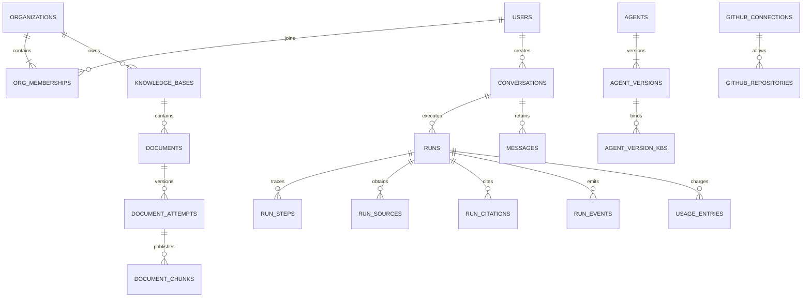

# 数据模型、事务与生命周期

> 版本 1.1 · 2026-11-09 · D02～D05 基础十六张表、D07 四张 Agent 表及 D08 七张运行表已创建，共二十七张 app 表。GitHub 与后续任务专属字段仍为设计；实际迁移差异见下文。对应 [技术方案](technical-design.md)、[PRD](PRD.md)、[D07记录](D07-Agent配置实施记录.md) 与 [D08记录](D08-持久运行与文档问答实施记录.md)。

## 目录导航

- [模型约定](#模型约定)
- [实体关系](#实体关系)
- [账号与组织](#账号与组织)
- [模型与资料](#模型与资料)
- [Agent 与 GitHub](#agent-与-github)
- [会话与运行](#会话与运行)
- [可靠性与审计](#可靠性与审计)
- [关键事务](#关键事务)
- [查询与生命周期](#查询与生命周期)
- [迁移与验收](#迁移与验收)

## 模型约定

- PostgreSQL 为唯一业务事实源。业务 ID 用 UUID，时间 timestamptz/UTC，文本 text，计数非负 integer/bigint，结构快照 jsonb；重要关系不藏在无约束 JSON 内。
- 除全局账号/会话、组织根表及可为空组织的创建幂等记录外，业务表均带 organization_id；所有同组织父子关系采用 `(organization_id, parent_id)` 复合外键，父表建立对应唯一键。仅内部运维角色可跨组织扫描。
- 表中未重复列出的公用字段：id、created_at；可编辑实体另有 updated_at、revision。deleted_at 是可见性 tombstone，不是运行/文档的新状态枚举。
- 数值上限和 DTO 命名以 [contracts](contracts.md) 为准；数据库 snake_case 映射 JSON camelCase。表名是设计名称，实现迁移必须保留语义对应。
- 业务 schema 为 app；LangGraph 适配器专用 schema 为 checkpoints，独立迁移步骤和凭据权限。checkpoint 结构不能作为公开 DTO。

## 实体关系

图只展示主关系；以下表格定义真实字段、约束和其他关系，不意味着可以省略组织复合外键。

## 账号与组织

| 实体 | 专属字段与类型 | 约束/索引 | 主要读写者 |
| --- | --- | --- | --- |
| users | normalized_email text、display_name text、password_hash text、password_changed_at timestamp | email 唯一；邮箱 trim + 小写，不擅自删除邮箱中的点或加号 | 注册/登录/账号设置 |
| auth_sessions | user_id nullable UUID、token_hash text、csrf_hash text、expires_at、last_seen_at、revoked_at timestamp | token_hash 唯一；user/expires 索引；user_id 为空仅用于匿名 CSRF，不能作为认证；原始随机 token 不入普通日志 | Cookie 认证与退出/改密撤销 |
| organizations | name text、owner_user_id UUID、access_revision bigint、settings_revision bigint | owner 非空；`(id, owner_user_id)` 对 memberships 的复合外键延迟到事务提交检查 | 组织创建、所有权转移、撤销串行锁 |
| org_memberships | organization_id、user_id UUID、base_role enum(admin,member)、joined_at timestamp | `(organization_id,user_id)` 唯一；FK users；有效角色由 owner_user_id 优先推导 | 成员管理、所有受保护用例 |
| org_settings | organization_id UUID、limits jsonb | organization_id 唯一；limits 只能降低部署硬上限；当前模型由相应 model_connection 指针唯一维护 | 设置、准备状态、运行接受 |

owner 不同时保存在 membership.role 和 organization.owner 两个字段中。API effectiveRole：user_id 等于 owner_user_id 时为 owner，否则为 base_role。创建组织与创建者 membership 同事务；转移时锁组织、验证目标 membership、修改 owner_user_id、把原 owner 的 base_role 设为 admin。外键防止移除当前 owner，组织始终有且仅有一个所有者。

## 模型与资料

D03 的 0003 迁移通过复合外键约束当前指针同组织/同连接，通过数据库触发器禁止更新 profile/connection version；组织锁保护测试后的发布。usage_entries 的未保存候选没有 profile，model_profile_id 可空；billed_units 独立保存提供方重排单位。run/step ID 暂为可空 UUID，相应外键随运行表迁移补齐。组织 limits 记录带 revision，尚未保存时读取部署默认值，不在启动时隐式建表或为所有组织写入设置。D04 的 0004 已建立文档表，Embedding 锁守卫读取真实 documents/document_attempts；接受与模型发布共用组织锁，上传与 S3 网络调用不占锁。

0004 将 document.current_attempt_id 设为非空，document 与 attempt 同事务创建、通过可延迟复合外键保证同组织/同文档。attempt 另保存 embedding_connection_id、limits_snapshot，与 profile/connection version 建立同组织/同连接外键。删除仅改 deleted_at、cleanup_status 并取消非终态 attempt；outbox 有 lease_token/lease_until、publish_attempts、available_at、last_error，失败不会抹掉接受事实。原对象已写但事务未确认时保留待孤儿清理，禁止在不确定提交结果下直接删对象。

| 实体 | 专属字段与类型 | 约束/索引 | 可见性/版本 |
| --- | --- | --- | --- |
| model_connections | organization_id、kind(chat,embedding,rerank)、name、active_profile_id、current_connection_version_id、enabled、tested_at、test_result、revision | 每组织每 kind 唯一；两个当前指针必须同 connection；保存候选测试成功后原子切换 | Agent 绑定逻辑连接，新 run 解析当前 profile/连接版本 |
| model_connection_versions | organization_id、connection_id、version_no、provider_protocol、base_url、credential_value | `(connection_id,version_no)` 唯一；不可变；URL 必须在部署允许域集合；凭据字段不进入任何公开 DTO | 运行和入库固化版本 ID；修改连接不把新凭据发送到旧地址 |
| model_profiles | organization_id、connection_id、provider_protocol、base_url、model_name、dimension nullable int、tokenizer_id、capabilities jsonb、parameters jsonb、version int | `(connection_id,version)` 唯一；embedding 的 dimension 非空；语义不可变；profile 与使用的连接版本协议/地址须一致 | 模型语义改变新 profile；仅换同地址凭据只新连接版本，不改变 Embedding profile |
| knowledge_bases | organization_id、name、normalized_name、description、deleted_at | 未删除 `(organization_id,normalized_name)` 唯一；组织/创建时间/ID 分页索引 | 删除前检查当前 Agent 绑定 |
| documents | organization_id、knowledge_base_id、original_name、content_type、size_bytes bigint、sha256、object_key、status、current_attempt_id UUID、deleted_at、cleanup_status、cleanup_error nullable text | KB/当前 attempt 复合 FK；status/文件名筛选；object_key 唯一；文件名不唯一 | 同名文件独立；只返回允许的元数据，object_key 不公开 |
| document_attempts | organization_id、document_id、attempt_no int、pipeline_version、embedding_profile_id、model_connection_version_id、status、error_code、started_at、finished_at、lease_owner、lease_generation bigint、lease_until、extracted_object_key、extracted_size nullable int、content_hash、chunk_count | `(document_id,attempt_no)` 唯一；处理状态与 document 状态对应；租约扫描索引 | 每次重试新版本；成功版本不改写；内部失败版不可检索 |
| document_chunks | organization_id、knowledge_base_id、document_id、attempt_id、ordinal int、text、text_hash、locator jsonb、lexemes tsvector、embedding vector、embedding_profile_id、embedding_dimensions int | `(attempt_id,ordinal)` 唯一；组织/KB/attempt B-tree；lexemes GIN；vector_dims 等于本行 dimensions 的 CHECK | 必须同时满足 document 未删除、ready 且 current_attempt_id 相等 |

locator 固定为 PDF 的 pageStart/pageEnd/段落序号，或 TXT/MD 的标题路径、段落序号和文本偏移；不对 TXT/MD 编造页码。embedding 采用无固定长度 vector，适配组织间不同维度；所有相似度计算先锁定一个 embedding_profile，禁止跨维度/模型排序。首版不建 ANN 索引。

分词与切片策略写入 pipeline_version。切片内容与版本一经发布不可修改。文档替换采用新文档；失败重试产生新 attempt，写完全部 chunks 后事务发布 current_attempt_id 和 ready。删除与发布都锁 document，删除赢得竞态后 worker 不能发布。

## Agent 与 GitHub

| 实体 | 专属字段与类型 | 约束/索引 | 消费者 |
| --- | --- | --- | --- |
| agents | organization_id、name、description、task_type、enabled、current_version_id、revision、disabled_at | task_type 固定 qa/compare/progress；编辑版本冲突 409 | Agent 目录、会话与权限 |
| agent_versions | organization_id、agent_id、version_no、name、description、prompt_text、chat_connection_id、parameters jsonb、created_by | `(agent_id,version_no)` 唯一，不可变；绑定逻辑连接，不保存凭据；task_type 从 agent 固定身份取得 | run 接受时固化实际 profile 与连接版本，历史审计显示实际模型 |
| agent_version_kbs | organization_id、agent_version_id、knowledge_base_id | `(agent_version_id,knowledge_base_id)` 唯一；复合组织 FK | 允许知识范围 |
| agent_version_tools | organization_id、agent_version_id、tool_key text | `(agent_version_id,tool_key)` 唯一；tool_key 必须属于服务端固定注册表 | Agent 工具选择；非可执行脚本 |
| github_connections | organization_id、name、credential_value、enabled、revision、tested_at、test_result | organization_id 唯一；固定 endpoint 不从表单读取任意 URL | MCP 连接与状态；DTO 只返回 hasCredential |
| github_repositories | organization_id、connection_id、github_repo_id bigint、owner、repo、enabled、verified_at | `(organization_id,github_repo_id)` 唯一；同连接 owner/repo 规范名唯一 | 仓库允许列表；更新改名时保持外部 ID |
| org_tool_settings | organization_id、tool_key、enabled、revision | `(organization_id,tool_key)` 唯一；只允许内置可配置工具 | 管理员工具启停，运行当前授权 |

工具定义、input/output Schema、只读属性属于版本化服务端注册表，不另建用户可编辑工具代码表。连接变更和工具停用递增组织 access_revision，旧 Agent 版本不能绕过当前 enabled 状态。停用 Agent 只改变当前使用资格，历史配置继续保留。

D07迁移`0006_agents`落地上方四张Agent表，共二十张app表。当前版本采用组织+Agent+version三列延迟FK，版本及绑定采用组织复合FK，数据库触发器禁止版本/关联UPDATE或DELETE、禁止修改task_type；API只向新版本插入关联。启停不修改版本。当前版本绑定（含停用Agent）阻止知识库删除；解绑发布新版本后可软删库，历史引用保留。没有Agent物理删除接口。仅新增表，无历史数据回填；降级会删除Agent数据，只用于隔离验收库，主库回滚保留表和数据。

## 会话与运行

D08 的 `0007_runs` 新增下列七张运行表，连同 D07 后共二十七张 app 表。当前只接受 `qa`，sources 仅文档且 document/attempt/chunk 为必填复合外键；未来 GitHub 扩展字段暂未建。step 的 `name` 承载 `knowledge.search/chat.generate/citation.validate`，另保存 `input_digest`；证据 hash/locator 与同组织同 run 的 citations FK 已落地。唯一活跃会话 run、唯一终态事件由部分唯一索引保护，usage 补充同 run/step 复合外键。业务迁移先于 checkpoint setup；降级删除运行表，仅允许在空隔离库验证，已有执行数据的环境保留表做前向修复。证据见 [D08 记录](D08-持久运行与文档问答实施记录.md)。

| 实体 | 专属字段与类型 | 约束/索引 | 说明 |
| --- | --- | --- | --- |
| conversations | organization_id、owner_user_id、agent_id、task_type、title、updated_at、revision | 0008增加revision默认1与组织/owner/更新时间/ID索引；agent/task_type创建后固定；重命名按revision防覆盖 | 成员私有列表；管理员从 run 审计，不代发 |
| messages | organization_id、conversation_id、run_id、role(user,assistant)、content、result_json nullable jsonb、is_partial bool、created_at | `(run_id,role)` 唯一；会话/创建时间/ID 索引 | 用户输入与一次助理结果；最终结构化结果/coverage 保存在 result_json；tool 不伪装成用户消息 |
| runs | organization_id、conversation_id、initiator_id、agent_version_id、status、cancel_requested、input_snapshot jsonb、config_snapshot jsonb、budget_snapshot jsonb、started_at、deadline_at、finished_at、last_seq bigint、lease_owner、lease_generation、lease_until、retry_of_run_id nullable、error_code、graph_version | 同 conversation 的非终态 run 部分唯一索引；org/status/time；过期 lease 索引；retry 复合组织 FK | 保留已经消耗的预算；当前授权另查，不信快照里的旧角色 |
| run_steps | organization_id、run_id、sequence bigint、logical_step_key、attempt_no、kind(model,tool,validation)、tool_key nullable、input_digest、input_summary jsonb、output_summary jsonb、status、error_code、started_at、finished_at、lease_generation | `(run_id,logical_step_key,attempt_no)` 唯一；`(run_id,sequence)` 唯一并用于轨迹排序，序号在 run 锁内分配 | 内部 step 状态不能冒充 run 业务状态；恢复按 logical_step_key 去重 |
| run_sources | organization_id、run_id、source_kind(document,github)、identity_key text、document_id/attempt_id/chunk_id nullable、repository_id nullable、external_type/number/url nullable、observed_at、content_hash、excerpt、locator jsonb、query_scope jsonb | `(run_id,identity_key)` 唯一；文档键为 document/attempt/chunk，GitHub 键为 repo/type/number/contentHash；每种来源必填字段 CHECK | 保留实际证据快照；删除来源后 excerpt 访问要拦截并按生命周期清除 |
| run_citations | organization_id、run_id、message_id、source_id、label、claim_path | source 与 message 都必须同 run/组织；`(run_id,label)` 唯一 | claim_path 可定位正文段落/表格行；标签不是模型自造主键 |
| run_events | organization_id、run_id、seq bigint、type、occurred_at、data jsonb | 主键 `(run_id,seq)`；终态事件每 run 唯一约束；事件 schema 版本在 data 内固定字段 | 先持久化再推 SSE；只存可公开投影，不存隐藏思维或凭据 |
| usage_entries | organization_id、run_id nullable、step_id nullable、operation_kind、operation_id、attempt_no、provider_request_id nullable、model_profile_id nullable、reserved_tokens、input_tokens nullable、output_tokens nullable、token_source(actual,reserved,unavailable)、billed_units jsonb、duration_ms、status | `(operation_kind,operation_id,attempt_no)` 唯一；org/time/run 索引 | 未保存候选没有 profile；包含入库、检索试查、连接测试；runId 为空的调用不虚算为 run |

input_snapshot 结构由 contracts 的任务 union 定义；config_snapshot 包含 Agent/模型/Prompt/图/工具 schema 版本和资料范围，禁止塞入完整连接凭据。budget_snapshot 固化生效上限；消费值从 usage/step 汇总并由 run 行锁保护预留。source 关联约束及引用归属必须在数据库约束和 service 二次校验中覆盖，不仅依赖前端。

模型快照包含实际 model_profile_id 和 model_connection_version_id。新 run 使用逻辑连接当前版本，已有 run 使用已固化版本；权限停用仍即时生效。聊天模型更换不要求批量改写 Agent 历史版本；同模型凭据轮换不造成 Embedding 索引 profile 不匹配。组织设置保存与 run/文档接受共用组织锁，避免读到一半更新的组合。

删除正文时保留被历史来源引用的 document/attempt/chunk 身份行，清除 chunk text/embedding、提取文本对象及 run_sources.excerpt，保留 hash/locator/tombstone；引用外键不悬空。有效片段必须有非空正文和向量，已删除/清理行不能参加检索；“成功版本不可修改”指可用内容，按既定删除流程清除负载是明确例外。GitHub 撤销仅限制读取，不自动改写历史快照。

## 可靠性与审计

| 实体 | 字段与约束 | 用途 |
| --- | --- | --- |
| outbox_jobs | organization_id、job_type、resource_id、resource_version、payload仅ID、available_at、publish_attempts、published_at、lease_until、last_error；业务去重键唯一 | 文档/run/清理投递；不传角色或凭据；发布和执行分别有幂等边界 |
| idempotency_keys | organization_id nullable、actor_id、operation、resource_id nullable、key、request_digest、response_status、response_data、target_id、created_at；作用域组合使用 NULLS NOT DISTINCT 唯一约束 | 接受操作与键同事务；账号级组织创建不依赖待创建组织 ID，空组织/资源也必须防重 |
| audit_entries | organization_id、actor_id、action、target_type、target_id、before_summary、after_summary、request_id、occurred_at、outcome | 资源管理及授权变更追溯；摘要不含密码/凭据/完整资料 |

checkpoint 表由选定 LangGraph PostgreSQL 适配器创建，不在业务 ORM 复制。thread_id 使用 `organizationId:conversationId:runId`，约 110 字符；调用者不能指定别人的 thread_id。每个 run 恢复使用原 ID，后续对话轮次使用新 run 的 thread；历史消息按当前权限从业务表装入。

## 关键事务

| 编号 | 同一事务内 | 事务外 | 并发/失败校验 |
| --- | --- | --- | --- |
| TX01 组织创建/转移 | org、membership、audit；创建时延迟 FK 检查 | 无 | 锁 org；不能移除 owner；同键创建只一个组织 |
| TX02 接受上传 | document、attempt、outbox、幂等记录 | 文件流校验与 S3 put | 摘要含 KB/文件 hash/名称；对象失败不返回 202 |
| TX03 发布文档 | 锁 document，验证未删除与 lease，发布版本及 ready | 解析/Embedding、chunks 暂存 | current_attempt 只能指同 document；未发布 chunks 不可检索 |
| TX04 接受 run | org/会话锁、当前权限、用户消息/run/outbox/幂等 | 无模型调用 | 非终态唯一；组织排队额度锁定检查 |
| TX05 调用预留/结算 | run 锁、step attempt、usage reserve/settlement | 网络调用 | 预留不足不调用；未知输出保留预留估算，恢复不退还已发出的请求 |
| TX06 终态 | run/权限检查、最终消息、citations、terminal event、用量结算 | 无 | 条件更新验证 generation 和状态；seq 分配同事务 |
| TX07 删除/撤销 | tombstone/授权 revision、audit、cleanup outbox | 对象与派生片段清理 | tombstone 立即可见；失败清理不恢复授权 |

## 查询与生命周期

主要查询：文档按 org/KB/status/文件名、Agent 按 org/enabled、会话按 org/owner/updatedAt、run 按 org/可见发起者/创建区间/status/Agent，事件按 run/seq。列表使用 `(排序时间,id)` 复合游标；更新中的会话排序允许重新刷新，但不能混合组织页面缓存。

检索先得到已授权、ready、current_attempt、匹配 embedding_profile 的候选集，再做向量/词项评分。精确搜索可用 MATERIALIZED 授权子查询限制输入；不能用先全库 topK 再应用权限的方式替代。中文分词与检索参数见 Agent 流程。

| 数据 | 保留与清理策略 | 权限/历史影响 |
| --- | --- | --- |
| 原文件/就绪 chunks | 活跃资料保留；删除后立即不可用，后台目标在 24 小时内完成清理 | 旧答案保留，引用 tombstone 保留；不再返回原文与 source excerpt |
| 上传孤儿/未发布临时文件 | 超过 24 小时且无活跃 DB 引用/lease 后清理 | 使用专用前缀，必须反查 DB，不能仅按文件名批量删 |
| 失败 attempt 派生数据 | 终止后 24 小时清理 chunks/提取对象；attempt 元数据保留 | 失败可重试，新 attempt 独立 |
| checkpoint | run 终态后保留 7 天供诊断，随后删除该 thread | 业务消息、引用、事件快照不依赖 checkpoint |
| 增量 run_events | 终态后 7 天可补发；清理后保留 run.lastSeq 和最终消息 | 旧游标返回契约错误，前端用快照恢复，不重建 run |
| messages/runs/citations/用量 | 首版不自动过期删除；每组织容量上限防止无限增加 | UI 提示保留到管理员部署级清理；首版无用户自助删除会话功能 |
| GitHub 证据快照 | 随所属 run 保留，但严格受当前仓库授权限制 | 撤销后所有正文/步骤/导出隐藏；权限恢复重新校验后可读 |
| sessions/操作审计 | 已过期/撤销 session 7 天后清理；audit/log 保留 30 天 | 不影响密码及组织归属；无凭据原文日志 |
| 幂等键 | 与目标记录共同保留；无目标的失败事务不留下已成功键 | 目标尚存时旧请求不能因键过期产生重复记录 |

上述时长的配置键与默认值在 contracts 维护；本节解释业务语义。容量触顶拒绝新的接受操作并说明原因，不自动删除用户记录。清理进程必须具备有界批量、重试与 requestId 日志。

## 迁移与验收

迁移顺序：账号/组织及延迟 owner FK → 配置/资料 → Agent/连接 → 会话/运行 → 证据/事件/用量/可靠性表；checkpoint 的适配器 setup 作为单独、幂等的维护步骤。每阶段迁移在空库及上一版数据库上验证；表结构变更明确回填和 rollback 限制。

必须验证：跨组织 FK 被拒；owner 转移/移除竞态；同会话双 run；幂等键同/异输入；删除与发布竞态；旧 lease 写入拒绝；终态唯一；引用同 run 归属；不同 Embedding 维度不混算；清理不影响活动记录。单元 mock 不能替代这些真实 PostgreSQL 集成用例。
