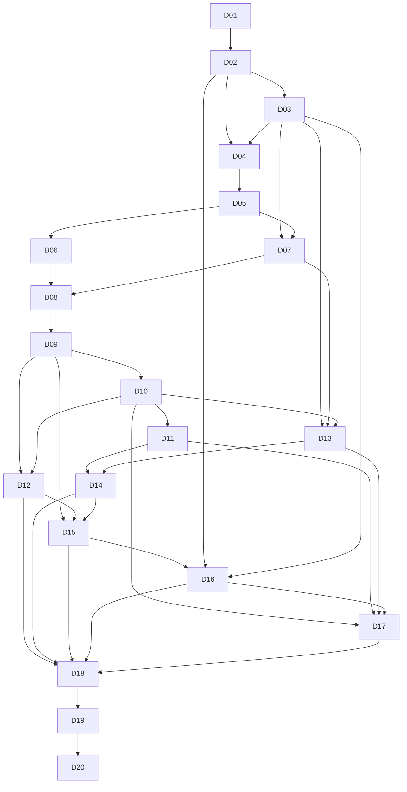

# 开发任务、依赖与验收清单

> 版本 1.0 · 进度更新2026-11-09 · D01～D09已实现；真实百炼与Linux队列单列验收，外部S3/GitHub MCP待验证；D10～D20未开始。范围依据[PRD](PRD.md)，技术依据[完整技术方案](technical-design.md)，每项进度和证据记录在对应任务下。

## 使用方式与完成定义

一次选择一个 D 编号实施：读对应规格 → 检查实际工程状态 → 实现最小范围 → 执行对应验证 → 保存证据与剩余问题 → 再选后续任务。不要一次把二十个任务交给模型要求“全部自动写完”。依赖未完成时只处理当前任务必要的前置，不能假造已有实现。

每项任务的完成必须同时有可运行行为、必要测试和可复查证据；写完文件、mock 演示、编译通过均不能单独替代业务验收。所有 PRD 验收编号保持原样，下面的映射说明实施责任，不表示已经通过。

## 里程碑与排期估算

| 里程碑 | 任务 | 可检查的阶段结果 |
| --- | --- | --- |
| A 工程与身份基础 | D01～D03 | 可复现启动，身份/组织隔离成立，模型配置和限制可验证 |
| B 文档问答闭环 | D04～D11 | 上传→检索→问答→引用→执行详情；具备停止、重连、恢复与用量。D09 可做第一次完整演示 |
| C 扩展任务与七模块 | D12～D16 | 双文档对比、真实 GitHub 只读总结、工作台与团队设置完整 |
| D 完整验收与交付 | D17～D20 | 撤销/清理闭环、全部 P0 验收、固定评测、部署复现与产品演示材料 |

按下面任务相加为 **110～170 小时**；每天 3～4 小时，约 **28～57 个投入日**，另预留约 20% 联调/返工时间。它是初始工作量估算，不是交付承诺；D09 用实际速度重新估算。完全 Vibe Coding 仍需读错误、准备真实账号和人工核对业务事实。

优先缩短首个闭环，而不删掉已确认 P0：先做 D01～D09 的必要页面和底层记录，D10/D11 补齐可靠性/统计，再扩展 T2/T3。新需求进入后续清单，不能悄悄挤入这些任务。开发默认串行；任务依赖表不代表授权启动并行 Agent。

## 依赖图

图为主要路径；任务中的“前置”是完整依赖集合。D08 已实现后台 trace/usage 和读取端点，D09 可显示简明步骤，D11 再完成 M6 全部列表/统计；不把看不到记录的聊天页面算完整演示。

## 任务详情

### D01 工程初始化与依赖兼容探针

- 前置：无；需用户明确开始代码实施；投入估算：4～6 小时。
- 输入：technical-design.md、architecture.md、quality.md。
- 工作：建立 Nuxt/FastAPI 共享后端骨架、pnpm/uv 锁文件、基础格式/类型检查、Compose 开发依赖；先做 Nuxt/Node、Python/SQLAlchemy/pgvector、LangGraph checkpoint、模型协议与 MCP 客户端最小兼容探针。
- 产出：真实目录、依赖锁、README 启动/验证命令；官方文档与版本证据表；健康探针。
- 验收：干净环境能按实际命令启动 Web/API/数据库；迁移与 checkpoint 初始化顺序明确；未拿到账号时将真实模型/MCP 项标为未验证，不伪造通过。
- 验证：构建/类型检查；健康探针；空库迁移 smoke；停止本次启动的服务并记录。
- 提示词：[D01](codex-prompts.md#d01)；PRD 编号见后方追踪表。

实施记录（2026-11-06）：D01 已验收。工程、锁文件、构建/类型检查、Docker 开发依赖、空库迁移、pgvector 查询、checkpoint 新连接恢复及 Web/API 就绪检查通过；真实模型/MCP 缺账号，按本任务约定保持 UNVERIFIED。实际命令与边界见 [D01 验证记录](D01-工程初始化验证.md)。D01 当次验证服务已停止、数据卷保留；后续体验环境和 D02 实施记录见下节。D01 是各业务 AC 的基础设施前置，不直接替代后方任一业务验收编号。

补验（2026-11-07）：百炼 Chat/Embedding 的真实 SDK 探针已通过；GitHub MCP 仍缺专用凭据。见 [百炼补充验收](D03-D04-百炼补充验收.md)。

### D02 身份、组织与权限基础

- 前置：D01；投入估算：6～8 小时。
- 输入：data-model.md、contracts.md AP01～AP15、backend.md、pages.md。
- 工作：实现用户、会话、组织、成员和单一 owner 约束；注册/登录/退出、创建/切换组织、CSRF 与当前成员校验；初版账号页。
- 产出：身份/组织迁移与服务、登录/注册/引导页；所有后续路由使用的授权入口。
- 验收：重复创建幂等；owner 恒唯一；其他组织资源 ID 不可见；退出/改密码撤销会话；角色不信客户端。
- 验证：真实 PostgreSQL 约束/事务测试；Cookie、CSRF、密码与跨组织 API 测试；登录到组织浏览器路径。
- 提示词：[D02](codex-prompts.md#d02)；PRD 编号见后方追踪表。

实施记录（2026-11-06）：D02 已验收。AP01～AP15、身份/组织迁移、注册/登录/引导/账号与基础团队页已落地；17 项 Python 测试、2 项前端单元测试、5 项隔离生产构建浏览器场景通过，证据见 [D02 记录](D02-身份组织实施记录.md)。M7-01/02/09 完成本阶段验收；D16 的完整设置交互与 D17 的运行中撤权仍待对应任务。D03 的后续实施状态见下节。

### D03 模型配置、能力测试与组织限制

- 前置：D02；投入估算：4～6 小时。
- 输入：contracts.md AP16～AP20、data-model.md、pages.md M7。
- 工作：实现三类模型连接/profile、最小输入测试、只写凭据 DTO、参数能力/tokenizer 验证、系统/组织限制；设置页。
- 产出：模型适配器基础、不可变 profile、设置接口和页面；调用计量基础。
- 验收：保存前测试候选，失败不覆盖生效配置；普通成员无凭据；已有文档锁定 Embedding 语义；上限只能降低。
- 验证：契约/权限/凭据投影测试；实际受支持提供方最小测试单列记录，stub 不算集成完成。
- 提示词：[D03](codex-prompts.md#d03)；PRD 编号见后方追踪表。

实施记录（2026-11-06）：D03 实现与本地验收完成。AP16～AP20、0003 迁移、三个模型设置与七项组织限制已落地；29 项 Python 测试、2 项前端单元测试、7 项隔离浏览器场景通过。M7-06 的候选测试/凭据投影、M7-07 的配置权限/硬值裁决、M7-08 的不可变版本/Embedding 锁均有本地证据；实际上传/run 接受及索引消费由后续任务验收。当时因无账号，真实提供方保持 UNVERIFIED，历史证据见 [D03 记录](D03-模型配置实施记录.md)。2026-11-07 已补验百炼聊天/Embedding/Rerank、API 测试并保存和用量落库，见 [百炼补充验收](D03-D04-百炼补充验收.md)。D04 状态见下节。

### D04 知识库与可靠文件接受

- 前置：D02、D03；投入估算：6～8 小时。
- 输入：contracts.md AP21～AP30/AP61、data-model.md TX02、pages.md M2。
- 工作：知识库维护、分页过滤、文件流校验、S3 临时对象、上传进度与取消传输、幂等接受、outbox；先只接受任务，不伪装 ready。
- 产出：知识库/文档 API 和列表/上传页；outbox dispatcher 基础；原请求查询。
- 验收：大小/MIME/空文件前后端同裁决；同名独立；单文件失败不影响其他项；对象成功但 DB 失败不产生假接受；同键重发不重复。
- 验证：真实 DB/S3 模拟器集成；接受响应丢失与重发；大小边界；多文件 UI。
- 提示词：[D04](codex-prompts.md#d04)；PRD 编号见后方追踪表。

实施记录（2026-11-07）：D04 本地验收完成。知识库维护、分页过滤、逐文件流校验、S3 原文、同键可靠接受与 AP61、outbox 投递/清理、上传进度及取消重试页面已实现；0004 新增四张表。50 项 Python、2 项前端单元、10 项隔离生产浏览器通过，SeaweedFS 文件在容器重启/重建后保持可读，空库/向量/checkpoint smoke 通过。M2-01/02/03/09 有本地证据；AP28/提取文本及解析/切片/Embedding 消费者属于 D05，M2-07/08 全部下游删除与绑定场景仍由 D17 验收。历史证据见 [D04 记录](D04-知识库实施记录.md)；同日已补验真实 Embedding 配置下的 202 接受、幂等重发、版本绑定与原文下载，见 [百炼补充验收](D03-D04-百炼补充验收.md)。外部 S3 未验证，D05 未开始。

### D05 文档解析、切片与向量入库

- 前置：D04；投入估算：6～10 小时。
- 输入：agent-flow.md 文档处理、data-model.md、contracts.md 文档状态。
- 工作：隔离 worker 解析 PDF/TXT/MD，定位/分词/切片/Embedding、attempt 租约与原子发布；失败原因/重试/文本预览。
- 产出：ingestion 任务、片段迁移、重试接口、处理状态与预览 UI；解析固定样例。
- 验收：损坏/加密/扫描无文本分别失败；未全量完成不 ready；重试新版本；删除与发布竞争不复活；模型/维度不混用。
- 验证：解析样例、真实 DB 发布竞态、worker 重启与重试；非就绪文档不可检索；真实 Embedding 小样例。
- 提示词：[D05](codex-prompts.md#d05)；PRD 编号见后方追踪表。

实施记录（2026-11-07）：D05 已实现解析/切片、0005片段表、租约/原子发布、真实Embedding、AP28重试/AP30文本/AP31管理员片段预览、Linux worker/dispatcher。解析和DB负向例、PDF/TXT/MD真实1024维入库、kill→真实租约到期失败→重启新attempt成功、浏览器预览/重试/手机布局已通过；空库迁移降级/重升通过。详细命令、最终汇总和边界见 [D05 记录](D05-文档入库实施记录.md)。M2-04及M2-05的文本/片段部分有证据；M2-05检索试查与M2-06留给D06，不宣称已有RAG答案。D06可开始，本次不推进。

### D06 授权混合检索与检索试查

- 前置：D05；投入估算：4～6 小时。
- 输入：agent-flow.md 查询、contracts.md AP31/AP32、data-model.md。
- 工作：范围预过滤、精确向量+中文词元关键词、RRF、Rerank、证据覆盖；管理员切片/检索试查。
- 产出：统一 retrieval service 与 typed RetrievalResult；中英固定检索样例。
- 验收：向量/关键词/重排每层只见授权片段；混合组织不同维度不会计算失败或泄漏；重排 index 校验；试查不建 run。
- 验证：检索命中与隔离测试；真实 PG 查询计划；重排异常/空结果/裁剪；真实 Rerank 探针。
- 提示词：[D06](codex-prompts.md#d06)；PRD 编号见后方追踪表。

D06 实施记录（2026-11-07）：AP32、物化授权混合检索/RRF/两协议重排、覆盖与独立用量、管理员试查已实现。94项Python回归、1项真实百炼检索、13项浏览器及静态检查/构建通过；中英2题Top1正确，属于小样本功能验收。详情见[D06记录](D06-混合检索实施记录.md)。下一任务为D07，本次未推进。

### D07 Agent 配置与不可变版本

- 前置：D03、D05；投入估算：6～10 小时。
- 输入：contracts.md AP33～AP38、data-model.md Agent、pages.md M3。
- 工作：三模板、提示词、知识库/模型/工具绑定、停用草稿、版本保存/复制/启停、readiness 与未保存提示。
- 产出：Agent CRUD（不含删除）、模板定义、管理/成员视图。
- 验收：类型创建后固定；停用可不完整，启用需可用；并发编辑不覆盖；复制停用且无凭据；历史版本保留；试运行只用已保存版。
- 验证：配置版本/乐观锁/引用范围服务测试；成员直链停用 Agent；脏表单与复制 UI。
- 提示词：[D07](codex-prompts.md#d07)；PRD 编号见后方追踪表。

D07实施记录（2026-11-08）：三模板/空白配置、四张Agent表与0006迁移、AP33～38及选项目录、不可变版本、复制/启停、角色投影和配置页面已实现。真实数据库专项6项、浏览器15项通过；迁移/类型/构建证据见[D07记录](D07-Agent配置实施记录.md)。M3-06本阶段验启停资格，运行中停止待D08/D10；M3-07本阶段验已保存版本说明和脏表单，真实试运行待D08/D09。未进入D08。

### D08 持久运行与 T1 Agent 执行

- 前置：D06、D07；投入估算：8～12 小时。
- 输入：agent-flow.md 全文、contracts.md AP49/AP53/AP54/AP58、data-model.md TX04～TX06。
- 工作：会话/run/消息/outbox、LangGraph 图、预算预留、step/usage、检索/候选生成/引用校验、唯一终态；先打通文档问答。
- 产出：共享 run service、QA 图、模型适配器、证据/引用/事件持久化、执行快照接口。
- 验收：每次真实调用可追溯；无证据如实说明；伪引用不能成功；同会话非终态唯一；聊天预算及失败尝试不漏记；已接受 run 可查询。
- 验证：图节点/预算/错误映射；真实 DB 事务和重复投递；固定 QA 四例；真实模型有来源答案单列验证。
- 提示词：[D08](codex-prompts.md#d08)；PRD 编号见后方追踪表。

D08实施记录（2026-11-09）：已新增持久run七表、共享运行service、LangGraph T1图、预算与调用用量、证据/引用/事件同事务终态和AP49/53/54/58；AP61支持运行接受核对。固定QA四例、真实PG/S3并发/负向验证及真实百炼/Linux队列验收见[D08记录](D08-持久运行与文档问答实施记录.md)。D09的后续实施证据见下方。

### D09 对话、SSE 恢复、来源与导出

- 前置：D08；投入估算：6～10 小时。
- 输入：pages.md M4、contracts.md AP48～AP61/SSE、frontend.md。
- 工作：任务表单、会话搜索/重命名、流式草稿、原 run 恢复、来源抽屉、简明步骤详情、最终 Markdown 导出与继续追问。
- 产出：可操作的文档问答闭环；SSE 客户端与快照协调；只读来源和导出。
- 验收：双击/响应丢失不重复 run；连续 seq 不漏终态；最终快照替换草稿；引用定位正确；管理员无代发入口；导出范围和限制完整。
- 验证：SSE 分片/多行/乱序/重复/游标过期；刷新/断网恢复 E2E；引用/导出与真实文档版本核对。
- 提示词：[D09](codex-prompts.md#d09)；PRD 编号见后方追踪表。

D09实施记录（2026-11-09）：对话工作台、私有会话搜索/重命名、原键核对、连续SSE与最终快照、来源/步骤/导出/追问已完成。完整浏览器17项及最终D09专项2项通过；Python、真实百炼来源读回、迁移数据保持见[D09记录](D09-对话与恢复实施记录.md)。M4-01只覆盖T1已开放表单，T2/T3随D12/D14；M4-06/07取消重试仍归D10。以下D10可以开始，但本次未执行。

### D10 取消、硬时限与进程恢复

- 前置：D08、D09；投入估算：6～8 小时。
- 输入：agent-flow.md 预算取消恢复、contracts.md 状态、data-model.md TX05/TX06。
- 工作：排队/运行取消、租约 generation、心跳、deadline/watchdog、补偿恢复、未知结果处理和人工新 run 重试。
- 产出：有限恢复路径、唯一终态裁决、取消/重试 UI 完整状态。
- 验收：取消先记录时不得成功；旧 worker 不可提交；恢复不重置预算/时限；部分模型流崩溃明确中断；新重试关联原 run。
- 验证：真实进程故障注入：领取/工具完成/终态提交窗口；取消成功竞争；多次取消及资源回收。
- 提示词：[D10](codex-prompts.md#d10)；PRD 编号见后方追踪表。

### D11 执行记录与用量统计

- 前置：D08、D10；投入估算：6～8 小时。
- 输入：pages.md M6、contracts.md AP54/AP57～AP60、data-model.md usage。
- 工作：运行列表筛选/分页、历史快照、步骤时间线、重试关联、队列/执行时间和用量统计；管理员只读审计。
- 产出：M6 列表/详情/统计接口和页面；错误行动提示。
- 验收：统计和列表权限/时间口径一致；零分母暂无；失败/取消/未知 usage 有标识；不记录隐藏思维链或凭据；查看不重跑。
- 验证：确定性统计数据、跨时区/跨零点、并发结算和重复事件对账；审计只读权限。
- 提示词：[D11](codex-prompts.md#d11)；PRD 编号见后方追踪表。

### D12 需求与方案对比流程

- 前置：D09、D10；投入估算：6～10 小时。
- 输入：PRD.md T2、agent-flow.md T2、contracts.md taskType=compare、pages.md M4。
- 工作：两文档输入、双侧检索、逐项对比结构、未检索到/冲突/覆盖说明、表格来源与导出。
- 产出：compare 图分支、表单和结果视图；固定对比样例。
- 验收：两份不同 ready 文档；每项可核对双侧或明确单侧缺证；长文裁剪披露；不声明未检索部分完全满足。
- 验证：T2 四个业务样例与非法输入；双侧证据定位；长文覆盖说明在页面和导出一致。
- 提示词：[D12](codex-prompts.md#d12)；PRD 编号见后方追踪表。

### D13 GitHub 只读 MCP 与连接管理

- 前置：D03、D07、D10；投入估算：6～10 小时。
- 输入：agent-flow.md 工具注册与GitHub、contracts.md AP39～AP46、pages.md M5。
- 工作：固定远程 MCP 传输、Schema 验证、只读 allowlist、凭据测试、精确仓库可读性验证、允许仓库/工具启停、结果归一。
- 产出：MCP adapter、工具注册表、连接与仓库管理页；真实 tools/list/call 证据与 Schema 指纹。
- 验收：不使用 REST/mock 冒充 MCP；模型不能扩仓库/切方法；远端写工具不注册；精确仓库验证不因空搜索成功；凭据不进入普通响应。
- 验证：真实只读 MCP；空仓库/不可读/认证失败/限流/Schema变化；跨仓库、写方法、Prompt 注入负向测试。
- 提示词：[D13](codex-prompts.md#d13)；PRD 编号见后方追踪表。

### D14 进展与风险总结流程

- 前置：D11、D13；投入估算：6～10 小时。
- 输入：PRD.md T3、agent-flow.md T3、contracts.md progress/Coverage、pages.md M4。
- 工作：单仓库/日期/时区/知识范围表单，计划检索、Issue/PR 查询与有界详情、去重/时间分类、分组输出与引用。
- 产出：progress 图分支、查询口径与覆盖信息、结果页面/导出；固定仓库资料包。
- 验收：至少一条真实 MCP 调用；两类必需查询均成功；空与失败分开；合并≠上线；缺负责人/截止日期待核实；部分样本不宣称全量。
- 验证：T3 六条 AC；固定四个业务样例；跨时区、分页截断、Issue/PR去重、连接失效及权限撤销。
- 提示词：[D14](codex-prompts.md#d14)；PRD 编号见后方追踪表。

### D15 工作台与首次使用串联

- 前置：D09、D12、D14；投入估算：4～6 小时。
- 输入：pages.md M1/引导、contracts.md AP47、PRD.md M1。
- 工作：三模板入口、个人最近会话、按模板 readiness、组织切换、缺失条件跳转；连通已有页面。
- 产出：工作台和无数据/失败状态；首次使用导航链。
- 验收：点击模板只预选；无 GitHub 不阻断 T1/T2；成员不看到他人会话；请求失败不假报准备完成；组织切换不闪旧数据。
- 验证：readiness 组合与角色测试；新账号到首个任务浏览器流程；工作台重试无付费调用。
- 提示词：[D15](codex-prompts.md#d15)；PRD 编号见后方追踪表。

### D16 成员管理与设置完整交互

- 前置：D02、D03、D15；投入估算：4～6 小时。
- 输入：pages.md M7、contracts.md AP05～AP20、PRD.md M7。
- 工作：补齐已注册账号核对/添加、任免管理员、转移/移除确认、模型生效状态/Embedding锁定、限制和账号页交互。
- 产出：M7 完整页面；与当前授权/版本规则一致的表单提示。
- 验收：owner 唯一且转移原子；admin不能提升/移除admin；普通成员无配置写权限；改密码全会话撤销；不增加邮件/SSO流程。
- 验证：所有权并发/目标刚被移除/重复成员；模型修改与入库竞争；键盘和错误保留字段。
- 提示词：[D16](codex-prompts.md#d16)；PRD 编号见后方追踪表。

### D17 撤销、删除和数据清理闭环

- 前置：D10、D11、D13、D16；投入估算：6～10 小时。
- 输入：PRD.md 6.3、data-model.md 生命周期、contracts.md 撤销、agent-flow.md 结果校验。
- 工作：统一 accessRevision、调用前后/交付检查、历史脱敏可见性、前端缓存失效、删除补偿、过期事件/checkpoint清理和容量保护。
- 产出：统一当前访问投影；清理任务及维护说明；资源已撤销 UI。
- 验收：文档删除即不可检索/预览；GitHub撤销隐藏混合回答/草稿/步骤/导出；已移除成员无任何组织读取；清理失败不恢复访问；不删除仍活跃对象。
- 验证：E2E-05/06 旧链接/旧页面/订阅/下载；删除发布竞争；清理错误恢复与保留期边界；跨组织原文/重排输入检查。
- 提示词：[D17](codex-prompts.md#d17)；PRD 编号见后方追踪表。

### D18 全页面状态、可访问性与交互收敛

- 前置：D12、D14、D15、D16、D17；投入估算：6～8 小时。
- 输入：pages.md 全文、frontend.md、PRD.md NFR。
- 工作：核对七模块空态/错误/处理中/无权限、窄屏抽屉、键盘焦点、中文文案、Markdown安全、页面离开资源回收。
- 产出：可重复 UI 验收步骤与必要组件测试；明确失败行动。
- 验收：核心流程键盘完成；来源抽屉焦点可返回；错误不只靠颜色；草稿不提前成功；反复进出不积累订阅；中英原文保留。
- 验证：Playwright 键盘/断线/窄屏/多文件用例；富文本注入；实际浏览器人工复核。
- 提示词：[D18](codex-prompts.md#d18)；PRD 编号见后方追踪表。

### D19 全部 P0 验收与固定业务评测

- 前置：D11、D12、D14、D17、D18；投入估算：6～10 小时。
- 输入：PRD.md 9、development-plan.md 验收追踪、quality.md、agent-flow.md 评测。
- 工作：按 87 条 AC 建证据矩阵，执行确定性边界/故障/隔离测试、六条 E2E、36 次真实业务评测和代表性容量测量。
- 产出：逐条通过/失败/未验证记录、固定 fixture/判定标准、模型/Prompt/文档版本和指标报告。
- 验收：全部确定性 P0 通过；每类4例×3次至少11/12；隔离/只读/伪引用/撤销零违规；剩余阻断项修复再局部重验；mock与真实结果分列。
- 验证：相关 unit/integration/contract/E2E 全集；真实模型与 MCP；2组织代表性数据的检索/运行时延与用量记录。
- 提示词：[D19](codex-prompts.md#d19)；PRD 编号见后方追踪表。

### D20 部署复现与产品演示交付

- 前置：D19；投入估算：4～8 小时。
- 输入：technical-design.md 运维、quality.md、PRD.md 完成定义。
- 工作：整理 Compose/迁移/备份恢复路径、README、演示样例、架构图、功能截图/演示流程、已知限制；验证干净环境复现。
- 产出：本地可复现交付包、真实验证证据索引、可用于 GitHub 展示的文档与演示素材。
- 验收：新环境按 README 可运行三任务；升级/失败回退路径可解释；样例只显式导入；任何真实发布/推送需用户另行指令，不把本任务当授权。
- 验证：干净环境启动/迁移/登录/三任务 smoke；示例数据隔离；停止 AI 启动服务；交付链接与命令实测。
- 提示词：[D20](codex-prompts.md#d20)；PRD 编号见后方追踪表。

## 验收追踪表

每个编号指定一个主要实现任务；D19 汇总全部验证证据。原文与具体预期以 [PRD](PRD.md) 对应行权威维护，以下不另造一份容易漂移的需求正文。

| PRD 编号 | 主任务 | 验证重点 |
| --- | --- | --- |
| M1-01 | D15 | 模板仅导航 |
| M1-02 | D15 | 本人最近会话 |
| M1-03 | D15 | 按模板准备状态 |
| M1-04 | D15 | 组织切换 |
| M1-05 | D15 | 空态与失败 |
| M2-01 | D04 | 知识库名称和编辑 |
| M2-02 | D04 | 逐文件校验 |
| M2-03 | D04 | 传输与处理区分 |
| M2-04 | D05 | 失败与新尝试 |
| M2-05 | D05 | 原文版本定位 |
| M2-06 | D06 | 授权检索试查 |
| M2-07 | D17 | 删除即时不可见 |
| M2-08 | D17 | 绑定阻止删库 |
| M2-09 | D04 | 分页筛选与同名 |
| M3-01 | D07 | 角色与启停可见性 |
| M3-02 | D07 | 三模板创建 |
| M3-03 | D07 | 资源绑定和启用校验 |
| M3-04 | D07 | 配置版本与未保存 |
| M3-05 | D07 | 独立停用副本 |
| M3-06 | D07 | 停用和在途影响 |
| M3-07 | D07 | 已保存配置试运行 |
| M4-01 | D09 | 三任务字段与范围 |
| M4-02 | D09 | 接受与幂等 |
| M4-03 | D09 | 草稿和终态区分 |
| M4-04 | D09 | 实际来源抽屉 |
| M4-05 | D09 | 固定会话与追问范围 |
| M4-06 | D10 | 停止唯一终态 |
| M4-07 | D10 | 当前配置新运行重试 |
| M4-08 | D09 | 原运行断线恢复 |
| M4-09 | D09 | 复制与导出 |
| M4-10 | D09 | 私有会话与只读审计 |
| M5-01 | D13 | 测试和凭据边界 |
| M5-02 | D13 | 连接状态与错误 |
| M5-03 | D13 | 精确允许仓库验证 |
| M5-04 | D13 | 单仓库参数约束 |
| M5-05 | D13 | 固定只读工具 |
| M5-06 | D17 | 撤销和历史隐藏 |
| M5-07 | D14 | GitHub归一与去重 |
| M5-08 | D14 | 分页和必需来源失败 |
| M6-01 | D11 | 运行列表作用域 |
| M6-02 | D11 | 历史配置快照 |
| M6-03 | D11 | 实际步骤摘要 |
| M6-04 | D11 | 失败尝试用量 |
| M6-05 | D11 | 成功率与区间 |
| M6-06 | D11 | 可行动错误 |
| M6-07 | D11 | 重试关联与失效来源 |
| M7-01 | D02 | 账号和会话 |
| M7-02 | D02 | 组织创建与隔离 |
| M7-03 | D16 | 已注册成员添加 |
| M7-04 | D16 | 唯一owner与角色 |
| M7-05 | D17 | 成员撤销生效 |
| M7-06 | D03 | 模型配置测试 |
| M7-07 | D03 | 组织限额只能降低 |
| M7-08 | D03 | 模型版本和索引锁定 |
| M7-09 | D02 | 显示名及密码撤销 |
| T1-AC01 | D08 | 有答案和有效引用 |
| T1-AC02 | D08 | 资料不足 |
| T1-AC03 | D08 | 冲突双方证据 |
| T1-AC04 | D09 | 同会话追问重检索 |
| T2-AC01 | D12 | 双侧差异与来源 |
| T2-AC02 | D12 | 未检索到明确标识 |
| T2-AC03 | D12 | 非法文档选择 |
| T2-AC04 | D12 | 长文覆盖与导出 |
| T3-AC01 | D14 | 真实MCP与计划 |
| T3-AC02 | D14 | 合并关闭不推导上线 |
| T3-AC03 | D14 | 空结果不等于零工作 |
| T3-AC04 | D14 | 必需连接失效 |
| T3-AC05 | D14 | 缺事实时待核实 |
| T3-AC06 | D14 | 日期仓库资料校验 |
| NFR-01 | D17 | 全路径组织隔离 |
| NFR-02 | D13 | 全链路只读 |
| NFR-03 | D10 | 预算边界和无新增调用 |
| NFR-04 | D10 | 持久接受与中断恢复 |
| NFR-05 | D09 | 幂等和事件恢复 |
| NFR-06 | D10 | 终态资源回收 |
| NFR-07 | D18 | 身份凭据与富文本 |
| NFR-08 | D18 | 键盘和焦点 |
| NFR-09 | D06 | 中文英文检索 |
| NFR-10 | D14 | 时区与可复现口径 |
| NFR-11 | D18 | 分页和即时反馈 |
| NFR-12 | D19 | 质量指标分开 |
| E2E-01 | D09 | 组织到问答引用 |
| E2E-02 | D12 | 对比到导出 |
| E2E-03 | D14 | GitHub到总结轨迹 |
| E2E-04 | D10 | 断网停止关联重试 |
| E2E-05 | D17 | 撤销后旧链接 |
| E2E-06 | D17 | 换组织审计注销 |
## 验证层级与证据格式

| 层级 | 必须回答的问题 | 实施阶段的主要证据 |
| --- | --- | --- |
| 单元/组件 | 输入和边界处理正确吗？ | 类型/Schema、模板结果校验、统计口径、前端状态测试 |
| 数据库/服务集成 | 事务、隔离、幂等、索引和回收成立吗？ | 真实 PostgreSQL、Redis、S3 测试环境；并发/故障注入记录 |
| API/事件契约 | 页面能按同一 Schema 恢复吗？ | OpenAPI 类型生成、错误响应、SSE 分片和连续 seq 测试 |
| 真实依赖集成 | 支持的模型和 MCP 真的可用吗？ | 提供方/模型/协议/Schema版本、最小真实调用和 usage；凭据不入报告 |
| 浏览器/E2E | 用户能完成需求路径吗？ | 六条 E2E、键盘、断线、来源撤销；实际浏览器结果 |
| 业务质量 | 结果有依据且对用户有用吗？ | 36 次固定评测；检索、事实、引用、任务完成分别记录 |
| 容量/运维 | 可复现运行与恢复吗？ | 代表性数据、机器/并发信息、P50/P95、迁移/恢复/清理证据 |

建议每条证据包含：需求编号、任务编号、测试样例/输入版本、环境与依赖版本、操作、预期、实际、PASS/FAIL/UNVERIFIED、证据路径、剩余问题。失败修复后只重跑受影响检查，避免无理由重复完整评测。模型结果波动必须保留三次运行，不能只挑成功一次截图。

D19 的“全部通过”仅在上述层级取得相应证据后使用；本规划交付只检查文档覆盖和一致性。任何真实账号、网络或模型缺失导致的未验证项需明确写出，不通过 mock 自动补绿。

## 任务执行纪律与范围变化

- 新依赖先查对应版本官方文档；生成锁文件后记录实际版本。D01 的兼容失败可以调整补丁版本或适配方式，但改变 PRD 行为需更新对应编号和契约。
- 前端/后端共享契约先改 contracts，再改 Schema、消费者与相关测试；不手写另一套冲突类型。不得借任务顺手重构无关模块。
- 每次完成输出：变更、验证结果、已知限制、下个依赖已满足的任务。自动启动的服务在验证结束后清理，只关闭本次启动的进程。
- 开发记录应区分设计完成、代码实现、mock通过、真实集成通过、浏览器验收和部署；不能跨级宣称。
- 本方案不授权创建 GitHub 仓库、提交、推送、发布或购买服务；这些动作按用户后续明确指令执行。

