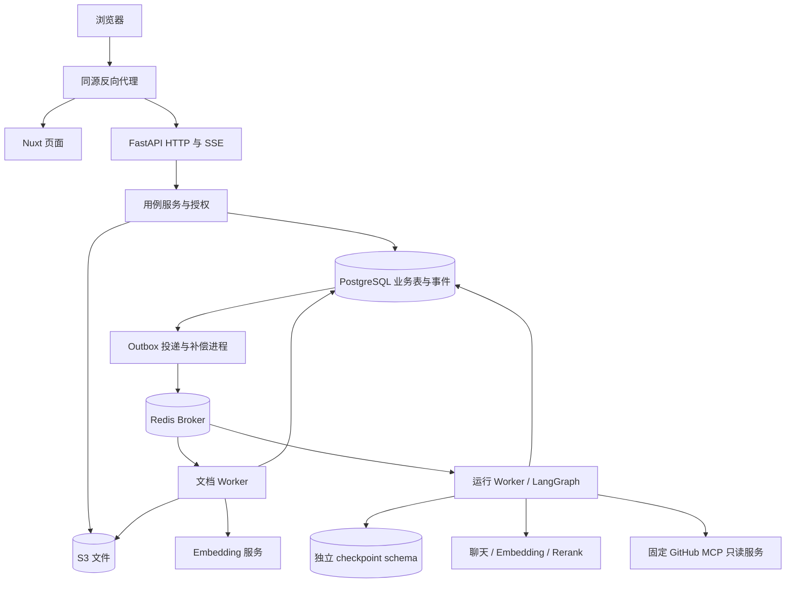
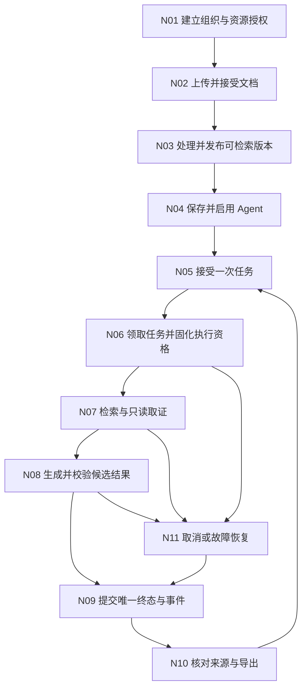
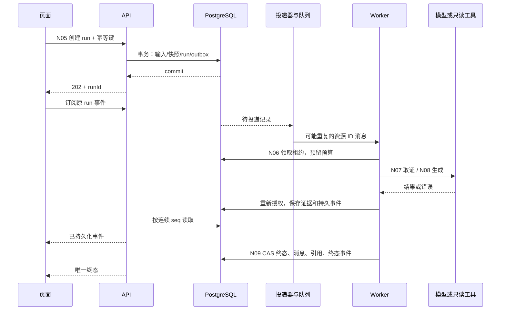

# Enterprise Agent Hub 技术方案

> 版本：1.0 · 2026-11-06 · 设计基线，按任务逐项落地。  
> 输入：[PRD](PRD.md) 的七模块、三类任务及 GitHub 只读范围。读者：实现者、评审者、验收人员。  
> D01～D11已实现：基础工程、身份/组织、模型配置、可靠上传、文档入库、授权检索、Agent不可变版本、持久T1问答、对话/SSE恢复/来源/导出、取消与有限进程恢复，以及执行记录和用量统计。阶段证据见[D01](D01-工程初始化验证.md)、[D02](D02-身份组织实施记录.md)、[D03](D03-模型配置实施记录.md)、[D04](D04-知识库实施记录.md)、[D05](D05-文档入库实施记录.md)、[D06](D06-混合检索实施记录.md)、[D07](D07-Agent配置实施记录.md)、[D08](D08-持久运行与文档问答实施记录.md)、[D09](D09-对话与恢复实施记录.md)、[D10](D10-取消与进程恢复实施记录.md)、[D11](D11-执行记录与用量实施记录.md)。真实百炼单列验证；D12及后续任务尚未实施，GitHub MCP/外部S3未验证。

## 目录导航

- [1. 目标](#1-架构目标与成功标准) · [2. 场景](#2-需求理解与业务场景) · [3. 权限与对象](#3-角色权限与核心业务对象) · [4. 边界](#4-系统边界与非目标)
- [5. 技术基线](#5-当前上下文与约束) · [6. 架构图](#6-整体架构图) · [7. 主流程](#7-系统主流程) · [8. 子流程](#8-子流程设计) · [9. 节点](#9-核心节点详细设计)
- [10. 状态机](#10-状态机设计) · [11. 数据流](#11-数据流设计) · [12. 时序](#12-时序设计) · [13. 模块](#13-模块架构与依赖方向)
- [14. 数据](#14-数据模型索引与生命周期) · [15. 契约](#15-api事件clihook-或-mcp-契约) · [16. 一致性](#16-一致性事务缓存与幂等) · [17. 异常](#17-异常重试补偿与人工修复)
- [18. 安全](#18-权限安全隐私与审计) · [19. 容量](#19-性能容量与可扩展性) · [20. 运维](#20-可观测性与运维策略)
- [21. ADR](#21-adr-决策记录) · [22. 风险](#22-风险取舍与待确认项) · [23. 开发任务](#23-开发任务拆分与里程碑) · [24. 设计检查](#24-architecture-review-checklist)

阅读顺序：本文 → [数据模型](data-model.md) → [接口契约](contracts.md) → [核心页面](pages.md) / [Agent 流程](agent-flow.md) → [开发任务](development-plan.md) → [Codex 提示词](codex-prompts.md)。已有 architecture/backend/frontend/agent/quality 是实现约束，本文给出本产品的具体设计。

## 1. 架构目标与成功标准

交付可演示的研发团队助手：资料入库、带依据的回答、真实只读 GitHub 调用、可恢复会话和可查执行记录。每个 PRD 验收编号必须有实现任务与验证归属，映射见开发任务清单。

成功意味着正常结果与失败结果均可解释、持久查询；权限在服务端执行；运行与文档有明确终态；同一请求重发不会产生第二次工作。设计完整性和运行验收分开，本轮仅检查前者。

## 2. 需求理解与业务场景

| 场景 | 业务主线 | 技术责任 | 成功信号 |
| --- | --- | --- | --- |
| T1 文档问答 | 找资料 → 答案 → 核对依据 → 追问 | 授权检索、上下文预算、引用校验 | 关键事实与真实文档片段对应 |
| T2 需求与方案对比 | 选两文档 → 对比 → 核对差异 | 双侧检索、证据分组、结构化行校验 | 不把检索未命中说成确定遗漏 |
| T3 进展与风险总结 | 选仓库/区间/计划 → 查询 → 总结 | MCP、时间口径、去重、覆盖说明 | 合并/关闭不被说成上线或验收 |
| 团队维护 | 配置资源 → 共享 → 使用 → 撤销 | 组织权限、版本、审计、历史可见性 | 旧链接和在途调用不能延续已撤销权限 |

## 3. 角色、权限与核心业务对象

角色沿用 PRD：owner 管理所有权与管理员；admin 管理普通成员及资源；member 使用启用 Agent、组织知识及允许仓库，只查看自己的会话/运行。owner/admin 的跨成员查看从审计入口进入，只读且不得代发或取消。

核心对象为账号、会话凭证、组织/成员、模型连接、知识库/文档版本、Agent 配置版本、GitHub 连接/仓库授权、对话、运行、证据、引用、事件与用量。无独立“项目”实体，无部门授权树。

## 4. 系统边界与非目标

浏览器访问同源 Nuxt 和 `/api/v1`，FastAPI 是业务入口。LLM 只能提出合法工具调用与候选答案；权限、预算、状态提交由确定性逻辑裁决。用户可配置组织模型和 GitHub 凭据，但不能指定任意 MCP 服务地址或启动命令。

不实现多 Agent 委派、任意脚本、GitHub 写入、自动改代码、长期记忆、定时业务周报、SSO、OCR、商业计费和工作流画布。后台补偿/清理调度是可靠性基础设施，不等于新增定时周报功能。

## 5. 当前上下文与约束

设计时只有 Markdown 文档。D01 已新增 Nuxt/FastAPI 骨架、迁移与锁文件，Git 仍未初始化；实际补丁版本、镜像摘要及验收边界见 [D01 记录](D01-工程初始化验证.md)。下表保留首版设计方向，未实施的业务不因基础骨架存在而视为完成。

| 层级 | 本方案选择 | 原因及验证边界 |
| --- | --- | --- |
| 前端 | Nuxt 4、Vue 3、TypeScript strict；pnpm；Node 24 基线 | 沿用原方案；Nuxt 官方现要求 Node 22+，初始化验证实际依赖组合 |
| UI | Tailwind CSS、shadcn-vue；局部状态 + Nuxt composable | 沿用原方案；组件版本按 Nuxt/Vue 兼容性锁定，不预建多余 store |
| API | Python 3.12、FastAPI、Pydantic 2 | DTO 与持久化实体分离；I/O 使用 async，阻塞解析离开 API 事件循环 |
| ORM/迁移 | SQLAlchemy 2.0 系列、psycopg 3、Alembic | 单一 ORM/迁移体系；每请求/任务独立 session，不跨并发任务共享 AsyncSession |
| Python 工具 | uv 锁依赖，Ruff 格式/lint，mypy 类型检查 | 单一管理和类型检查路线；不额外维护 Poetry/pip-tools 配置 |
| 数据 | PostgreSQL 18 + pgvector，Redis 7 系列 | PostgreSQL 拥有业务状态；Redis 只承载 Celery broker，首版不用 Redis 缓存权限 |
| 异步执行 | Celery 5 系列；独立 ingestion/run 队列；数据库 outbox | 队列重复投递可发生；业务租约与幂等保证状态，不把 Celery 状态当业务事实 |
| Agent | LangGraph + PostgreSQL checkpointer | 图只在后端运行；无 Agent Server/LangSmith 托管依赖；每 run 有独立恢复上下文 |
| 文件 | S3 协议；开发验证可用 LocalStack S3，演示验收需实际配置的 S3 兼容服务 | 通过 boto3 适配；API 中同步 SDK 工作置于有界线程池；不把模拟器通过等同真实存储验收 |
| 模型 | Chat Completions 支持 OpenAI/百炼分支，Embeddings 复用兼容协议，Rerank 支持 Cohere v2/百炼原生协议 | 面向所选协议，不承诺所有“兼容”供应商均支持；组织设置测试能力后才启用，Qwen 使用固定官方 tokenizer |
| 测试/部署 | Pytest、Vitest、Playwright；Docker Compose、同源反向代理 | 第一版单机模块化部署，不引入 Kubernetes、独立向量库或事件平台 |

模型名称、服务账号和凭据由部署者提供；这是接入输入，不影响本方案接口与模块职责。没有凭据时只能完成离线验收，真实联调保持未验证。Chat Completions 用于本项目跨提供方兼容目标；OpenAI 官方对其新项目推荐 Responses，不能将本选择表述为 OpenAI 的通用推荐。

关键官方依据（2026-11-06 核对；非兼容性测试）：[Nuxt 安装](https://nuxt.com/docs/4.x/getting-started/installation)、[FastAPI 并发](https://fastapi.tiangolo.com/async/)、[SQLAlchemy AsyncSession](https://docs.sqlalchemy.org/en/20/orm/extensions/asyncio.html)、[Alembic](https://alembic.sqlalchemy.org/en/latest/tutorial.html)、[uv 项目](https://docs.astral.sh/uv/guides/projects/)、[Celery 任务](https://docs.celeryq.dev/en/stable/userguide/tasks.html)、[LocalStack S3](https://docs.localstack.cloud/aws/services/s3/)。具体使用方式须在 D01 核对选中版本。

## 6. 整体架构图

这些进程共享同一个 backend 代码包；只有部署进程分工，没有额外业务微服务。客户端既不能直接访问数据库/模型，也不直接连接 GitHub MCP。

## 7. 系统主流程

先完成文档问答的垂直流程，再实现 T2 和 T3 专用节点。所有阶段共享身份、资料、运行、事件与引用模型，后续不另建一套任务系统。

## 8. 子流程设计

| 子流程 | 入口与输入 | 步骤 | 出口与失败 |
| --- | --- | --- | --- |
| SF01 文档接受 | 管理员、知识库、文件、幂等键 | 流式校验并计算摘要 → 临时对象写入 → DB 写文档/attempt/outbox → 返回 202 | 接受前失败不创建可见文档；对象孤儿由清理任务回收 |
| SF02 文档处理 | 文档/attempt ID | 领取租约 → 隔离解析 → 切片 → 批量 Embedding → 事务切换 currentVersion | 只在全部成功后 ready；失败片段不参与检索 |
| SF03 运行接受 | 会话、结构化任务输入、幂等键 | 当前授权 → 锁组织/会话 → 幂等检查 → 预算/配置/范围快照 → 用户消息/run/outbox 同事务 | 重发返回原 run；并发冲突保留输入 |
| SF04 取证和回答 | 当前有效 run | 图节点校验 → 工具取证 → 候选生成 → 引用和范围校验 → CAS 终态 | 必需工具故障明确失败；无答案按证据不足返回 |
| SF05 撤销/删除 | 管理员变更 | DB 变更访问版本 → 新请求立即拒绝 → worker/流/导出检查 → 后台清理 | 已下载内容无法追回；平台不继续提供被撤销正文 |
| SF06 断线/重启 | 原 runId、连续事件游标 | 查询快照 → 补发原事件；worker 由租约补偿接管 | 不创建新 run；无法安全续算时 RUN_INTERRUPTED |

## 9. 核心节点详细设计

| 节点 | 前置/输入 | 读写及外部依赖 | 成功/失败与幂等 |
| --- | --- | --- | --- |
| N01 | 有效账号与角色 | users/sessions/memberships/settings；无外部模型 | 事务创建组织及 owner；唯一成员键；越权拒绝 |
| N02 | owner/admin、有效文件 | S3 临时对象；documents/attempt/outbox/idempotency | 返回已接受身份；同键异内容 409；对象写入失败不接受 |
| N03 | 有效 attempt、未删除文档 | 解析子进程、Embedding、chunks/version | 租约 generation 拦截旧 worker；全量版本原子可见 |
| N04 | 知识库/模型/工具可用 | agents/versions/绑定表 | 乐观版本防覆盖；启用检查；不创建 run |
| N05 | 自己的会话、有效范围 | messages/runs/outbox/幂等记录 | 会话唯一非终态约束；配置快照只存 ID/版本，不存凭据 |
| N06 | 排队或可恢复运行 | 组织并发名额、run 租约、首次 startedAt/deadline | 只一个有效持有者；重启不重置 deadline/预算 |
| N07 | 当前授权和剩余预算 | RAG/GitHub；run_steps/run_sources/usage | 调用前持久预留；工具结果与资格校验后保存；重试计数不重置 |
| N08 | 已取得证据 | 模型调用、候选文本、引用映射 | 暂存增量；无有效引用不能成功；验证不通过可在原预算内修正 |
| N09 | 有效 leaseGeneration 与终态资格 | 同事务写 final message、citations、run、terminal event | 同 run 只一个终态；过期 worker 的更新影响零行 |
| N10 | 当前会话/审计与来源权限 | 读取保存结果；后端生成 Markdown 下载 | 不重新调用模型；仓库撤销时混合回答正文隐藏 |
| N11 | cancelRequested、租约丢失、超时或故障 | 核对 DB/checkpoint/call 状态；关闭本次外部连接 | 安全结果复用；模型结果未知或已有未完成流则明确失败，不盲目拼接重生成 |

## 10. 状态机设计

文档和运行的完整枚举、错误码、初始数值唯一维护于 [contracts](contracts.md#状态与初始限额)。本文不新增业务终态。

| 对象 | 允许转换 | 条件与非法转换 |
| --- | --- | --- |
| 文档 | queued → processing → ready/failed；failed → queued | 重试新 attempt/version；ready 不原地重处理；删除独立 deletedAt，禁止 worker 复活 |
| 运行 | queued → running → 终态；queued 可取消或以排队超时失败 | 首次开始固定 deadline；running 恢复仍 running；任何终态不可退回 |
| 取消 | 非终态设置 cancelRequested → worker/服务端裁决 | 前端先显示“正在停止”；已终态取消返回原终态 |
| 配置 | 新版本保存，启用/停用为资源状态 | 引用有效版本；旧版本只读；停用不删除历史 |

## 11. 数据流设计

原文件 → 私有 S3 对象 → 提取文本/版本 → chunks + Embedding → 授权候选集 → 重排 → run_sources → 候选答案 → citations/final message。每次衍生保留来源身份，引用从实际证据 ID 生成，不接受模型自行构造文档 ID 或 URL。

GitHub 连接凭据仅传给固定服务；返回内容归一为仓库/Issue或PR/时间/正文摘要。仓库 ID 与组织允许列表再次核对后才能进入 run_sources。用量按实际调用 attempt 入账，包含取消/失败与估算标记。

## 12. 时序设计

API 首版从 PostgreSQL 增量拉取 run_events 推送 SSE；不依赖 Redis Pub/Sub 保证事件送达。此选择适合首版容量，测量压力后再加通知优化。

## 13. 模块架构与依赖方向

沿用 [architecture](architecture.md) 的目录。新增代码按任务逐步落地，目录说明不是现在创建空工程的要求。

| 模块 | 入口/职责 | 消费者 |
| --- | --- | --- |
| api + schemas | auth/org/knowledge/agent/conversation/run/connection/settings 路由与 DTO | Nuxt、契约测试 |
| services + repositories/models | 业务事务、权限、组织范围查询、配置版本 | API、worker、工具 |
| rag | 解析、分词、切片、检索、重排；输入显式授权范围 | ingestion、Agent、检索试查 |
| agent + tools + mcp | 图状态、预算与执行；受限工具；外部协议适配 | run worker |
| workers | Celery 入口、outbox 投递、租约回收、删除补偿 | 持久化任务 |
| apps/web | 页面、输入、流恢复、来源与轨迹展示 | 用户；不裁决权限 |
| tests/fixtures | 固定事实与故障样例；与真实集成分开 | 单元、集成、契约、E2E、业务评测 |

## 14. 数据模型、索引与生命周期

见 [data-model.md](data-model.md)。业务表默认带组织范围；users/auth_sessions 为账号全局表，checkpoint 为独立基础设施 schema。核心业务关系使用复合组织外键，不能只靠 UUID 难猜保证隔离。

资料/连接删除与历史访问不同：文档删除保留已生成答案但引用正文不再可读；仓库/连接撤销隐藏含该来源的混合答案与步骤内容。数据清理计划只删除已明确进入保留期或 tombstone 的数据，不顺手清空业务记录。

## 15. API、事件、CLI、Hook 或 MCP 契约

HTTP/DTO/SSE/数值集中在 [contracts.md](contracts.md)；页面到接口对应见 [pages.md](pages.md)。MCP 对外工具协议适配归 [agent-flow.md](agent-flow.md)，不向前端暴露 SDK 对象。

CLI/Hook：N/A，首版不是可分发 CLI/Hook 产品。未来启动、迁移与验证命令只在工程建立后写入 README 并实际执行；本文不提供假定已存在的 npm scripts。

## 16. 一致性、事务、缓存与幂等

1. 上传：先在事务外写临时对象，再在一个 DB 事务写文档、attempt、outbox、幂等结果。DB 失败导致的孤儿对象由按前缀/时间与数据库反查的清理处理；不宣称 S3 与 DB 有分布式事务。
2. run：锁组织后锁会话，检查并发/幂等/资格，原子提交用户消息、run、outbox。outbox 发布成功后才标投递；发布成功但标记失败可能重复投递，由领取条件防重。
3. run 的 startedAt、deadline、预算已消费值不因 Celery 重发或进程重启变小。调用前写 reserved usage，调用后按实测结算；未知用量按预留估算。
4. 终态提交锁同一个 run，校验 leaseGeneration、cancelRequested、deadline 和当前访问；最终消息/引用/状态/事件同事务。只有一次胜出，其他完成路径返回现有状态。
5. 运行最终提交与组织撤销使用相同锁顺序：organization → conversation/run → source resources；撤销递增 accessRevision，交付检查当前 revision。外部调用不占数据库事务。
6. 只缓存静态工具 Schema。权限从 DB 判断；Nuxt 查询 key 含 organizationId/资源 ID，退出/切组织清缓存；动态内容不交给公共 CDN 缓存。

## 17. 异常、重试、补偿与人工修复

| 故障 | 自动处理 | 用户结果 / 人工处理 |
| --- | --- | --- |
| 上传对象成功但 DB 失败 | 孤儿对象定期回收；重发按输入摘要识别 | 未接受，允许重试；无假文档 |
| Broker 不可用/重复投递 | outbox 重试；DB lease 防重复执行 | queued 可查询；超过排队时限明确失败 |
| Worker 崩溃 | 过期 lease 被补偿器回收，旧 generation 不能提交 | 安全节点可恢复；流中断/未知模型结果明确失败 |
| 模型/工具限流或超时 | 只对暂时性故障退避，服从总预算 | 保留失败原因和部分内容；人工重试新 run |
| 引用校验失败 | 原预算内修正；无法修正则失败 | 不提供带伪引用的成功结果 |
| 权限/资料被撤销 | 下一次调用/事件/结果交付检查拒绝 | 隐藏撤销内容或标记来源删除；不使用旧授权续跑 |
| 对象/切片清理失败 | 保留 tombstone 与 cleanup outbox，有限重试 | 资料仍不可见；管理员凭 requestId 查看维护日志并重投同一清理任务 |
| 无法恢复的 checkpoint | 保存 RUN_INTERRUPTED，不绕过权限重建旧任务 | 用户使用当前配置重新执行，新旧 run 关联 |

不得通过手改数据库把失败 run 置为成功。运维重投只针对幂等内部任务；模型业务重跑必须留下新的 run。

## 18. 权限、安全、隐私与审计

选用随机不透明会话 Cookie + 数据库会话撤销记录；密码使用 Argon2id 哈希。Cookie 属性、时长、CSRF 与同源规则见 contracts。普通应用响应不含提供方凭据、哈希密码、对象存储内部键或 checkpoint。

组织管理配置的凭据保存在后端专用连接记录字段，只有服务访问路径读取；不返回到编辑表单，界面只展示 hasCredential。存储加密可由部署数据库/存储层提供，本方案不额外强制引入 secretRef 或新的密钥系统。配置格式由初始化确定并避免公开响应/日志泄露，遵循项目现有策略。

成员/Agent/连接/仓库范围在每个工具调用和结果提交时复核。撤销后服务器立即拒绝新访问；页面通过 accessRevision 轮询和重新聚焦刷新清理旧内容，已合法下载或已显示到用户屏幕的内容不能承诺远程抹除。Markdown 禁止原始 HTML/脚本，仅允许受限链接协议。

审计记录资源配置、成员、所有权和删除变更的操作者/对象/时间/结果，不记录原始密码或凭据。模型输入、文档及 MCP 返回值都是资料，不能成为更高权限指令。

## 19. 性能、容量与可扩展性

设计验证包取 2 组织、每组织 10 用户、100 文档、10,000 切片；这些是测试数据规模，不是已测承载量。资源限额集中在 contracts，范围内仍可能因依赖故障失败。

首版 pgvector 使用授权候选集内精确余弦检索；组织、知识库与版本过滤先于候选返回和重排。关键词分词与 GIN 检索并行，RRF 合并后重排。暂不建立跨租户全局 HNSW 来冒充授权预过滤；需要提速时以查询计划、召回和隔离测试决定索引。依据：[pgvector 过滤与索引](https://github.com/pgvector/pgvector#filtering)。

验收先记录普通查询 P50/P95、入库时长、检索时长、首事件/首答案耗时与 Token，性能报告注明机器和数据量。不能用 120 秒硬超时冒充平均响应时间目标。

## 20. 可观测性与运维策略

Docker Compose 规划服务：proxy、web、api、run-worker、ingestion-worker、dispatcher、postgres、redis；S3 开发模拟器为单独测试 profile。Python 进程共用一个镜像与依赖锁。Windows 开发的 worker 在 Linux 容器运行，避免默认承诺原生 Windows Celery 行为。

启动顺序：数据库健康 → 显式迁移（业务与 checkpoint 分开）→ 其他服务 → ready 探针。API liveness 不访问外部依赖；readiness 检查 DB/配置；模型与 GitHub 故障只影响对应任务准备状态。迁移失败停止启动，禁止自动 destructive reset。

记录 requestId/runId/stepId、队列年龄、过期 lease、outbox 积压、失败码、Token 来源、检索命中、配置/Prompt/图版本。日志与成员可见轨迹分离。服务重启后同一 run 可恢复或可解释失败；版本不兼容的 checkpoint 不强行恢复。

部署使用数据库备份和私有对象存储；升级前验证迁移，回滚优先代码回滚或数据库备份恢复，禁止把 Alembic downgrade 当作无损保证。清理只按数据模型定义的范围执行。AI 开发验收启动的服务需记录 PID/端口，结束后停止。

## 21. ADR 决策记录

| 编号 | 问题与选择 | 备选及未采用原因 | 代价/验证 |
| --- | --- | --- | --- |
| ADR-01 | 模块化后端 + 多 worker 进程 | 独立 RAG/Agent 微服务会提前增加部署和一致性负担 | 故障隔离靠进程/队列；压测后再考虑拆分 |
| ADR-02 | PostgreSQL 业务状态 + outbox + lease | 仅 Celery result backend 不能覆盖接受与投递之间的窗口 | 增加少量内部表；故障注入验证 |
| ADR-03 | 不透明 Cookie 会话 | 前端保存 bearer token 增加恢复/撤销路径 | 每次访问查询会话；用真实撤销测试验证 |
| ADR-04 | 精确向量检索 + 分词关键词 + RRF + Rerank | 纯向量遗漏关键词；无分词中文全文检索不足；先建 ANN 使过滤/召回更复杂 | 精确检索成本较高，首版控制数据量并测量 |
| ADR-05 | 固定官方远程 GitHub MCP，只读且本地工具允许列表 | 任意 MCP 或任意 REST 代理会扩大信任边界；本轮不增加本地服务部署选择器 | 依赖网络/提供方可用性；真实只读探针是 D13 前置 |
| ADR-06 | 业务消息存 DB；每 run 独立 checkpoint thread | 直接把会话 ID 作为跨运行 graph 状态容易复用取消/预算状态 | 多保存一份有限恢复数据；不保存跨会话 store |
| ADR-07 | 首版保留受控失败路径 | 部分流已展示后自动重生成可能重复/改写答案 | 该类进程中断失败，用户显式重试，符合 PRD 恢复或明确失败 |

## 22. 风险、取舍与待确认项

| 风险/输入 | 当前设计决定 | 验证或调整点 |
| --- | --- | --- |
| 提供方兼容性、账号权限 | 不指定付费模型；必须支持流、工具、结构化结果校验和可预算输入 | D01/D08/D13 记录模型 ID、能力、真实 usage 和失败样例；不支持就不启用 |
| 中文分词、复杂 PDF、证据覆盖 | 中文统一分词；不做 OCR；保留页码及覆盖限制 | 固定集验证，不把 extraction 成功等同信息完整 |
| 多组件开发量 | 依赖顺序交付一个垂直流程，再补齐全部 P0 | D09 首轮可用后复估余量；任务时间是估算，不承诺四周内完成 |
| GitHub 远程服务变化 | 固定地址、只读头、已知 Schema 指纹；异常阻止使用 | D13 验证真实 tools/list/call；服务不匹配需修订适配，不暗中启用写工具 |
| 文档规则与技术选择 | 新增技术细节可由后续验证修订，PRD 范围不变 | 若必须改变产品行为，先明确修订 PRD 对应编号 |

没有需要现在阻塞文档交付的业务问题。凭据、部署域名、精确依赖补丁号、真实性能基线是实施输入/验证结果，不能由文档编写虚构。

## 23. 开发任务拆分与里程碑

详见 [development-plan.md](development-plan.md)：D01～D20 按依赖推进，分为工程基础、文档问答闭环、两类扩展任务、全部 P0 验收四段。每项包含工作范围、预期验收、测试层级、投入估算与对应提示词；执行时一次只选择一个任务。

## 24. Architecture Review Checklist

| 检查 | 设计落点 | 实现后的验收证据 |
| --- | --- | --- |
| 主流程、节点、接口可追踪 | 本文 N01～N11、contracts、任务矩阵 | 请求到持久记录到最终页面同 runId |
| 状态/取消/恢复不互相矛盾 | §10/16/17、Agent 流程 | 竞态、重启、重复消息测试 |
| 所有核心实体有归属与约束 | data-model | 跨组织外键、唯一键、迁移及权限测试 |
| 中文检索与引用不靠猜测 | agent-flow | 固定事实/无答案/冲突/中文关键词案例 |
| 工具只读与当前授权 | contracts、agent-flow | 越界参数/撤销/写工具负向测试 |
| 页面覆盖正常和失败状态 | pages | 键盘、断线、无权限、空态 E2E |
| 任务覆盖全部 87 个 PRD 编号 | development-plan | 覆盖表逐条关联实际验证记录 |
| 部署与兼容有实测边界 | D01/D20 | 锁文件、实际启动、迁移、真实模型/MCP 证据 |

当前结论：这是后续实施的设计基线；以上运行证据均待代码实现后取得。
